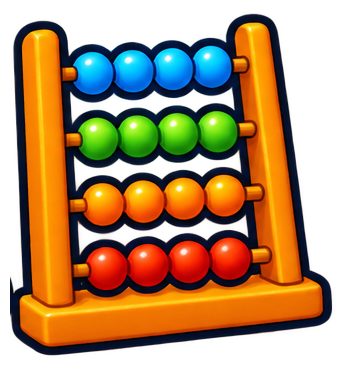
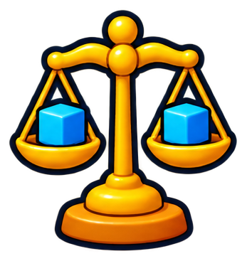
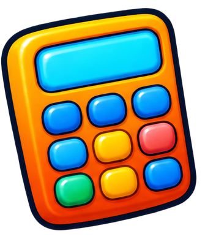
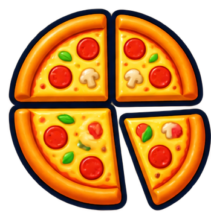
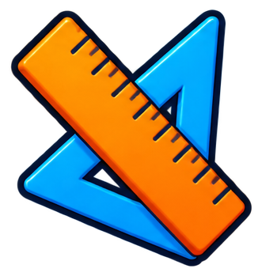

# iconos/aritmetica

10 imágenes · [← volver al índice](../CATALOGO.md)

| Imagen | Id y qué contiene | Materia · grado | Calidad |
|:--:|---|---|:--:|
|  | **`icono-aritmetica-abaco`** Ábaco con cuentas azules, verdes, naranjas y rojas `abaco` `aritmetica` `contar` `cuentas` `estilo-sticker` | aritmetica | 5★ |
|  | **`icono-aritmetica-balanza`** Balanza de platillos dorada con dos cubos azules `aritmetica` `balanza` `comparar` `equilibrio` `estilo-sticker` | aritmetica | 5★ |
|  | **`icono-aritmetica-calculadora`** Calculadora naranja con teclas de colores `aritmetica` `calculadora` `estilo-sticker` `operaciones` | aritmetica | 5★ |
|  | **`icono-aritmetica-libro-lapiz`** Libro abierto con un lápiz `aritmetica` `cuaderno` `escribir` `estilo-sticker` `lapiz` `libro` | aritmetica | 5★ |
|  | **`icono-aritmetica-monedas-apiladas`** Torres de monedas doradas apiladas `apiladas` `aritmetica` `dinero` `estilo-sticker` `monedas` | aritmetica | 5★ |
|  | **`icono-aritmetica-pizza-fracciones`** Pizza partida en porciones separadas (fracciones) `aritmetica` `estilo-sticker` `fracciones` `partes` `pizza` `porciones` | aritmetica | 5★ |
|  | **`icono-aritmetica-regla-escuadra`** Regla naranja y escuadra azul `aritmetica` `escuadra` `estilo-sticker` `geometria` `medir` `regla` | aritmetica | 5★ |
|  | **`icono-aritmetica-signo-dividir`** Signo de dividir (÷) naranja `aritmetica` `dividir` `division` `estilo-sticker` `signo` | aritmetica | 5★ |
|  | **`icono-aritmetica-signo-mas`** Signo de más (+) naranja `aritmetica` `estilo-sticker` `mas` `signo` `suma` | aritmetica | 5★ |
|  | **`icono-aritmetica-signo-por`** Signo de multiplicar (×) naranja `aritmetica` `estilo-sticker` `multiplicar` `por` `signo` | aritmetica | 5★ |
