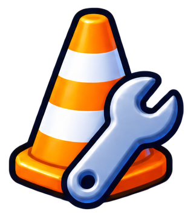
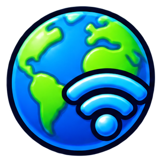
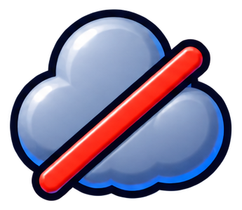

# interfaz/estado

3 imágenes · [← volver al índice](../CATALOGO.md)

| Imagen | Id y qué contiene | Materia · grado | Calidad |
|:--:|---|---|:--:|
|  | **`icono-en-construccion`** Cono de obra con llave inglesa: en construcción `construccion` `estado` `estilo-sticker` `obra` `proximamente` | — | 5★ |
|  | **`icono-en-linea`** Planeta Tierra con señal wifi: en línea (conectado) `conectado` `en-linea` `estado` `estilo-sticker` `internet` `wifi` | — | 5★ |
|  | **`icono-sin-internet`** Nube azul tachada con una línea roja: sin internet `desconectado` `error` `estado` `estilo-sticker` `nube` `sin-internet` | — | 5★ |
