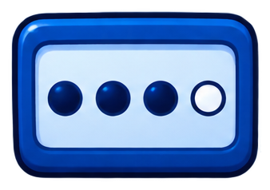

# interfaz/login

5 imágenes · [← volver al índice](../CATALOGO.md)

| Imagen | Id y qué contiene | Materia · grado | Calidad |
|:--:|---|---|:--:|
|  | **`login-candado-abierto`** Candado verde abierto con marca de verificación `abierto` `acceso` `candado` `desbloqueado` `estilo-sticker` `login` | — | 5★ |
|  | **`login-pin-cuatro-puntos`** Campo de PIN de cuatro puntos (tres llenos y uno vacío) `clave` `codigo` `contrasena` `estilo-sticker` `login` `pin` | — | 5★ |
|  | **`login-candado-cerrado`** Candado dorado cerrado `bloqueado` `candado` `cerrado` `estilo-sticker` `login` `seguridad` | — | 4★ |
|  | **`login-gafete-estudiante`** Gafete o credencial de estudiante con cordón azul `credencial` `estilo-sticker` `estudiante` `gafete` `identificacion` `login` | — | 4★ |
|  | **`login-llave-dorada`** Llave dorada con una estrella `acceso` `dorada` `entrar` `estilo-sticker` `llave` `login` | — | 4★ |
