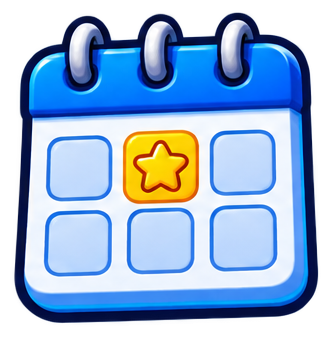
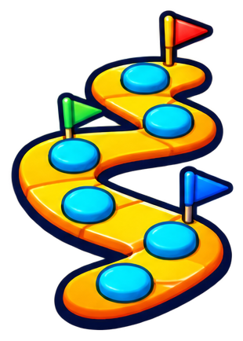
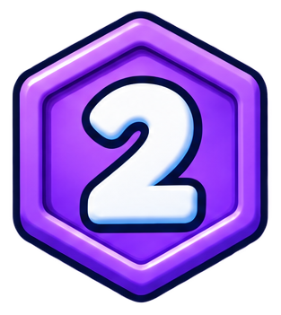
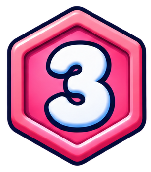

# interfaz/periodos

6 imágenes · [← volver al índice](../CATALOGO.md)

| Imagen | Id y qué contiene | Materia · grado | Calidad |
|:--:|---|---|:--:|
|  | **`periodo-calendario-semana`** Calendario de semana con una estrella dorada `calendario` `estilo-sticker` `estrella` `periodos` `semana` | — | 5★ |
|  | **`periodo-camino-tablero`** Camino de juego de mesa con casillas y banderas `camino` `estilo-sticker` `periodos` `progreso` `ruta` `tablero` | — | 5★ |
|  | **`periodo-periodo-1`** Insignia hexagonal verde con el número 1 (período 1) `1` `estilo-sticker` `hexagono` `insignia` `periodo` `periodos` | — | 5★ |
|  | **`periodo-periodo-2`** Insignia hexagonal morada con el número 2 (período 2) `2` `estilo-sticker` `hexagono` `insignia` `periodo` `periodos` | — | 5★ |
|  | **`periodo-periodo-3`** Insignia hexagonal rosa con el número 3 (período 3) `3` `estilo-sticker` `hexagono` `insignia` `periodo` `periodos` | — | 5★ |
|  | **`periodo-periodo-4`** Insignia hexagonal amarilla con el número 4 (período 4) `4` `estilo-sticker` `hexagono` `insignia` `periodo` `periodos` | — | 5★ |
