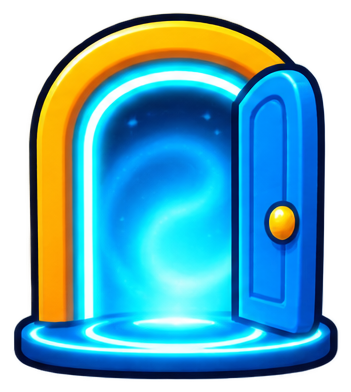

# interfaz/portada

5 imágenes · [← volver al índice](../CATALOGO.md)

| Imagen | Id y qué contiene | Materia · grado | Calidad |
|:--:|---|---|:--:|
|  | **`portada-cohete-despegando`** Cohete rojo y blanco despegando con estrellas `cohete` `despegar` `espacio` `estilo-sticker` `inicio` `portada` | — | 5★ |
|  | **`portada-emblema-escudo-cohete`** Emblema: escudo azul con un cohete y una estrella `cohete` `emblema` `escudo` `estilo-sticker` `estrella` `portada` | — | 5★ |
|  | **`portada-planeta-anillo`** Planeta naranja con anillo y estrellas `anillo` `espacio` `estilo-sticker` `estrellas` `planeta` `portada` | — | 5★ |
|  | **`portada-portal-entrada`** Portal de entrada azul brillante con una puerta abierta `entrada` `estilo-sticker` `portada` `portal` `puerta` | — | 5★ |
|  | **`portada-tablet-carita`** Tablet con carita sonriente `carita` `estilo-sticker` `portada` `tablet` `tecnologia` | — | 5★ |
