# juego

37 imágenes · [← volver al índice](../CATALOGO.md)

| Imagen | Id y qué contiene | Materia · grado | Calidad |
|:--:|---|---|:--:|
| 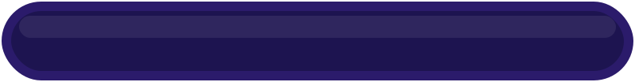 | **`barra-xp-marco`** Marco de barra XP `kit` `barra` `juego` `icono` | — | 5★ |
|  | **`barra-xp-relleno`** Relleno de barra XP `kit` `barra` `juego` `icono` | — | 5★ ✂ |
| 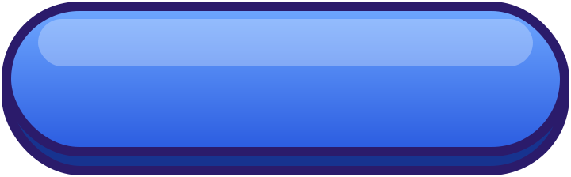 | **`boton-azul`** Botón sin texto: azul `kit` `boton` `juego` `icono` | — | 5★ |
| 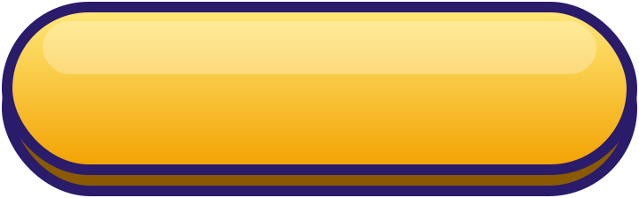 | **`boton-dorado`** Botón sin texto: dorado `kit` `boton` `juego` `icono` | — | 5★ |
| 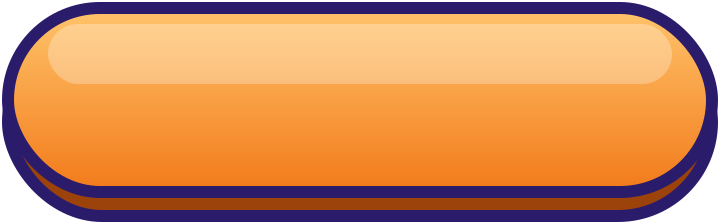 | **`boton-naranja`** Botón sin texto: naranja `kit` `boton` `juego` `icono` | — | 5★ |
| 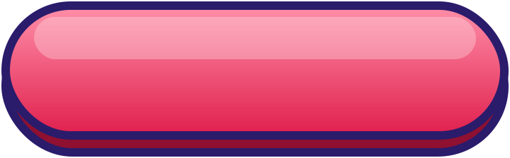 | **`boton-rojo`** Botón sin texto: rojo `kit` `boton` `juego` `icono` | — | 5★ |
| 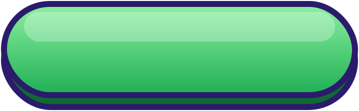 | **`boton-verde`** Botón sin texto: verde `kit` `boton` `juego` `icono` | — | 5★ |
| 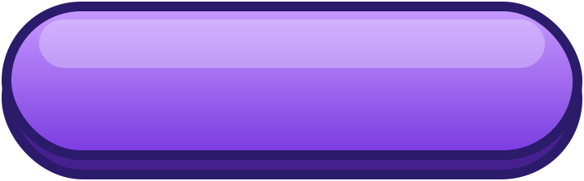 | **`boton-violeta`** Botón sin texto: violeta `kit` `boton` `juego` `icono` | — | 5★ |
|  | **`candado`** Bloqueado `kit` `candado` `juego` `icono` | — | 5★ |
|  | **`candado-abierto`** Desbloqueado `kit` `candado` `juego` `icono` | — | 5★ |
|  | **`casi`** Casi/otra vez `kit` `casi` `juego` `icono` | — | 5★ |
|  | **`cinta`** Cinta de título (sin texto) `kit` `cinta` `juego` `icono` | — | 5★ |
| 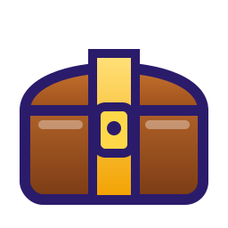 | **`cofre`** Cofre cerrado `kit` `cofre` `juego` `icono` | — | 5★ |
|  | **`cofre-abierto`** Cofre abierto con premio `kit` `cofre` `juego` `icono` | — | 5★ |
|  | **`cohete`** Cohete (siguiente) `kit` `cohete` `juego` `icono` | — | 5★ |
| 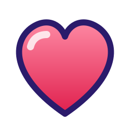 | **`corazon`** Vida (llena) `kit` `corazon` `juego` `icono` | — | 5★ |
|  | **`corazon-vacio`** Vida gastada `kit` `corazon` `juego` `icono` | — | 5★ |
|  | **`destello`** Brillo/partícula `kit` `destello` `juego` `icono` | — | 5★ |
|  | **`escudo`** Escudo/insignia `kit` `escudo` `juego` `icono` | — | 5★ |
|  | **`estrella`** Estrella de puntuación `kit` `estrella` `juego` `icono` | — | 5★ |
| 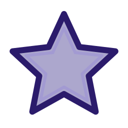 | **`estrella-vacia`** Estrella sin ganar `kit` `estrella` `juego` `icono` | — | 5★ |
| 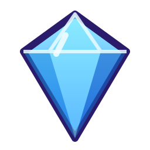 | **`gema`** Gema `kit` `gema` `juego` `icono` | — | 5★ |
|  | **`globo`** Globo de diálogo (sin texto) `kit` `globo` `juego` `icono` | — | 5★ |
| 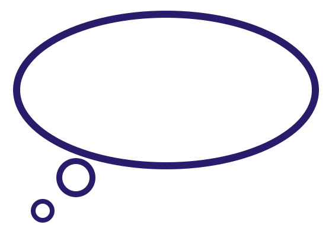 | **`globo-pensar`** Globo de pensamiento `kit` `globo` `juego` `icono` | — | 5★ |
| 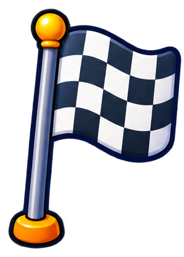 | **`icono-bandera-meta`** Bandera de cuadros blanca y negra de meta `bandera` `estilo-sticker` `final` `llegada` `meta` | — | 5★ |
|  | **`icono-boton-jugar`** Botón verde redondo de jugar (play) `boton` `empezar` `estilo-sticker` `jugar` `play` | — | 5★ |
|  | **`icono-check-acierto`** Marca de verificación blanca sobre círculo verde (acierto) `acierto` `bien` `check` `correcto` `estilo-sticker` | — | 5★ |
| 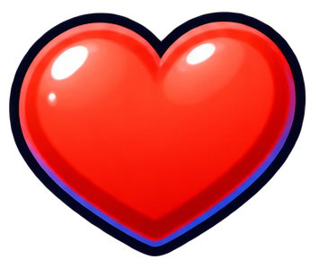 | **`icono-corazon-vida`** Corazón rojo brillante (vida) `corazon` `estilo-sticker` `vida` `vidas` | — | 5★ |
| 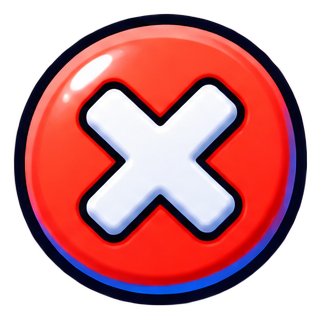 | **`icono-equis-error`** Equis blanca sobre círculo rojo (error) `equis` `error` `estilo-sticker` `incorrecto` `mal` | — | 5★ |
|  | **`icono-estrella-xp`** Estrella dorada de puntos de experiencia (XP) `estilo-sticker` `estrella` `experiencia` `puntos` `xp` | — | 5★ |
| 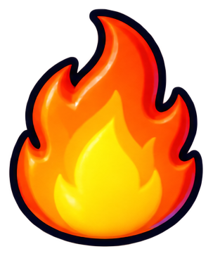 | **`icono-llama-racha`** Llama de fuego (racha de aciertos) `aciertos` `estilo-sticker` `fuego` `llama` `racha` | — | 5★ |
|  | **`icono-moneda-estrella`** Moneda dorada con una estrella `estilo-sticker` `estrella` `moneda` `premio` `recompensa` | — | 5★ |
|  | **`llama`** Racha `kit` `llama` `juego` `icono` | — | 5★ |
|  | **`moneda`** Moneda `kit` `moneda` `juego` `icono` | — | 5★ |
|  | **`ok`** Acierto `kit` `ok` `juego` `icono` | — | 5★ |
|  | **`pista`** Pista `kit` `pista` `juego` `icono` | — | 5★ |
|  | **`estrella-dorada-brillante-con-destellos-21de`** Estrella dorada brillante con destellos `4°` `5°` `aritmetica` `estrella` `logro` `puntos` `tecnologia` | aritmetica, tecnologia · grado 4, 5 | 4★ |
