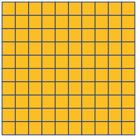
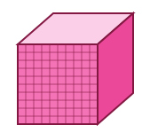

# matematicas/base10

4 imágenes · [← volver al índice](../CATALOGO.md)

| Imagen | Id y qué contiene | Materia · grado | Calidad |
|:--:|---|---|:--:|
|  | **`mate-bloque-centena`** Bloque de base 10: centena (placa de 100) `base10` `bloques` `centena` `matematicas` `valor-posicional` | — | 5★ |
|  | **`mate-bloque-decena`** Bloque de base 10: decena (barra de 10) `base10` `bloques` `decena` `matematicas` `valor-posicional` | — | 5★ |
|  | **`mate-bloque-millar`** Bloque de base 10: millar (cubo de 1000) `base10` `bloques` `matematicas` `millar` `valor-posicional` | — | 5★ |
|  | **`mate-bloque-unidad`** Bloque de base 10: unidad (1 cubito) `base10` `bloques` `matematicas` `unidad` `valor-posicional` | — | 5★ |
