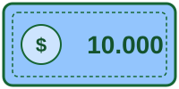
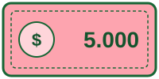

# matematicas/dinero

7 imágenes · [← volver al índice](../CATALOGO.md)

| Imagen | Id y qué contiene | Materia · grado | Calidad |
|:--:|---|---|:--:|
|  | **`mate-billete-10000`** Billete genérico de 10000 (ilustración original, no es un billete real) `10000` `billete` `dinero` `matematicas` `pesos` | — | 5★ |
|  | **`mate-billete-2000`** Billete genérico de 2000 (ilustración original, no es un billete real) `2000` `billete` `dinero` `matematicas` `pesos` | — | 5★ |
|  | **`mate-billete-5000`** Billete genérico de 5000 (ilustración original, no es un billete real) `5000` `billete` `dinero` `matematicas` `pesos` | — | 5★ |
|  | **`mate-moneda-100`** Moneda genérica de 100 (ilustración original, no es una moneda real) `100` `dinero` `matematicas` `moneda` `pesos` | — | 5★ |
|  | **`mate-moneda-1000`** Moneda genérica de 1000 (ilustración original, no es una moneda real) `1000` `dinero` `matematicas` `moneda` `pesos` | — | 5★ |
|  | **`mate-moneda-200`** Moneda genérica de 200 (ilustración original, no es una moneda real) `200` `dinero` `matematicas` `moneda` `pesos` | — | 5★ |
|  | **`mate-moneda-500`** Moneda genérica de 500 (ilustración original, no es una moneda real) `500` `dinero` `matematicas` `moneda` `pesos` | — | 5★ |
