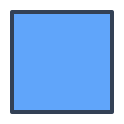
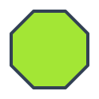
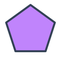
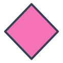
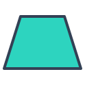
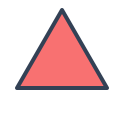

# matematicas/geometria

9 imágenes · [← volver al índice](../CATALOGO.md)

| Imagen | Id y qué contiene | Materia · grado | Calidad |
|:--:|---|---|:--:|
|  | **`mate-fig-circulo`** Círculo (figura geométrica) `circulo` `curva` `figura` `geometria` `matematicas` | — | 5★ |
|  | **`mate-fig-cuadrado`** Cuadrado (figura geométrica) `cuadrado` `figura` `geometria` `matematicas` `poligono` | — | 5★ |
|  | **`mate-fig-hexagono`** Hexágono (figura geométrica) `figura` `geometria` `hexagono` `matematicas` `poligono` | — | 5★ |
|  | **`mate-fig-octogono`** Octágono (figura geométrica) `figura` `geometria` `matematicas` `octogono` `poligono` | — | 5★ |
|  | **`mate-fig-pentagono`** Pentágono (figura geométrica) `figura` `geometria` `matematicas` `pentagono` `poligono` | — | 5★ |
|  | **`mate-fig-rectangulo`** Rectángulo (figura geométrica) `figura` `geometria` `matematicas` `poligono` `rectangulo` | — | 5★ |
|  | **`mate-fig-rombo`** Rombo (figura geométrica) `figura` `geometria` `matematicas` `poligono` `rombo` | — | 5★ |
|  | **`mate-fig-trapecio`** Trapecio (figura geométrica) `figura` `geometria` `matematicas` `poligono` `trapecio` | — | 5★ |
|  | **`mate-fig-triangulo`** Triángulo (figura geométrica) `figura` `geometria` `matematicas` `poligono` `triangulo` | — | 5★ |
