# personajes/boli

21 imágenes · [← volver al índice](../CATALOGO.md)

| Imagen | Id y qué contiene | Materia · grado | Calidad |
|:--:|---|---|:--:|
|  | **`boli-birrete`** Bolí con birrete de graduación y un diploma `birrete` `boli` `diploma` `estilo-sticker` `graduacion` | — | 5★ |
| 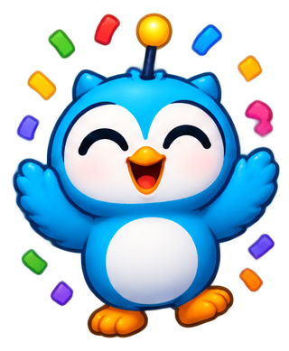 | **`boli-celebra`** Bolí celebrando con confeti de colores `boli` `celebrar` `confeti` `estilo-sticker` `logro` | — | 5★ |
| 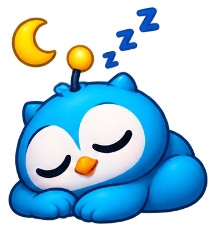 | **`boli-duerme`** Bolí dormido con una luna y «zzz» `boli` `descanso` `dormir` `estilo-sticker` `luna` | — | 5★ |
| 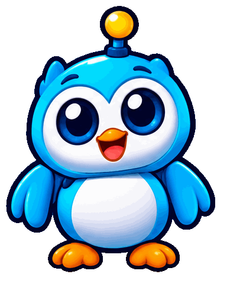 | **`boli-quieto`** Bolí de pie en pose neutra `boli` `estilo-sticker` `neutro` `quieto` | — | 5★ |
| 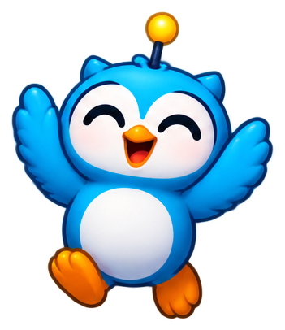 | **`boli-salta`** Bolí saltando de alegría con las alas arriba `alegria` `boli` `estilo-sticker` `saltar` | — | 5★ |
| 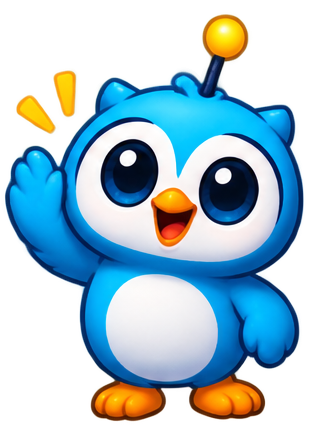 | **`boli-saluda`** Bolí saludando con una ala `boli` `estilo-sticker` `hola` `saludar` | — | 5★ |
| 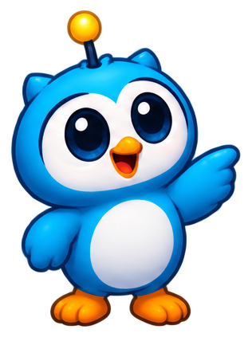 | **`boli-senala`** Bolí señalando hacia un lado `boli` `estilo-sticker` `indicar` `senalar` | — | 5★ |
|  | **`boli-trofeo`** Bolí con un trofeo dorado `boli` `estilo-sticker` `ganador` `premio` `trofeo` | — | 5★ |
|  | **`boli-v2-birrete`** Bolí (versión 2) con birrete y diploma, guiñando un ojo `boli` `boli-v2` `diploma` `estilo-sticker` `graduacion` | — | 5★ |
| 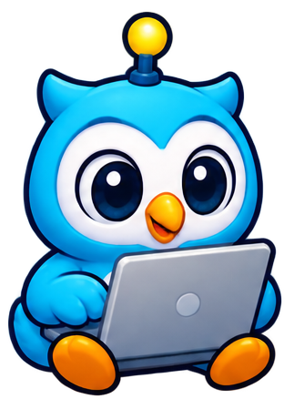 | **`boli-v2-laptop`** Bolí (versión 2) sentado con una laptop `boli` `boli-v2` `computador` `estilo-sticker` `laptop` `tecnologia` | — | 5★ |
| 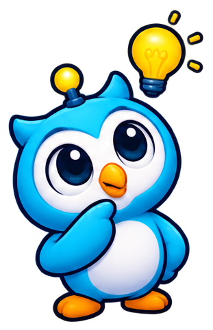 | **`boli-v2-piensa`** Bolí (versión 2) pensando con una bombilla `boli` `boli-v2` `estilo-sticker` `idea` `pensar` | — | 5★ |
| 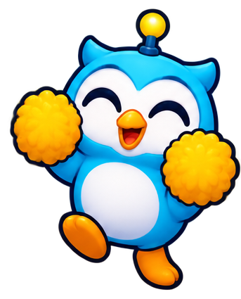 | **`boli-v2-pompones`** Bolí (versión 2) animando con pompones amarillos `animo` `boli` `boli-v2` `estilo-sticker` `pompones` `porra` | — | 5★ |
| 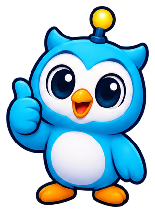 | **`boli-v2-pulgar`** Bolí (versión 2) con el pulgar arriba `bien` `boli` `boli-v2` `estilo-sticker` `pulgar-arriba` | — | 5★ |
| 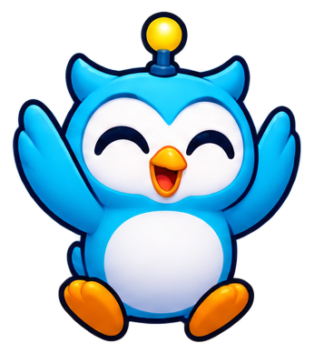 | **`boli-v2-salta`** Bolí (versión 2) saltando de alegría `alegria` `boli` `boli-v2` `estilo-sticker` `saltar` | — | 5★ |
| 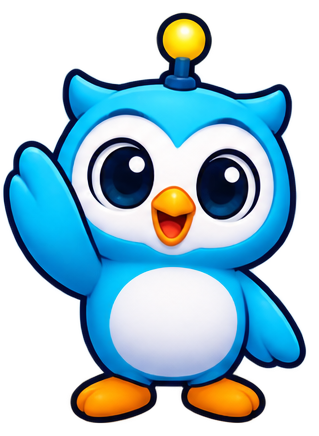 | **`boli-v2-saluda`** Bolí (versión 2) saludando `boli` `boli-v2` `estilo-sticker` `hola` `saludar` | — | 5★ |
| 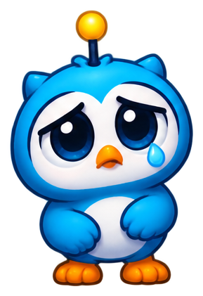 | **`boli-animo`** Bolí (ave azul con antena dorada) con ojos llorosos, para dar ánimo `animo` `boli` `error` `estilo-sticker` `triste` | — | 4★ |
| 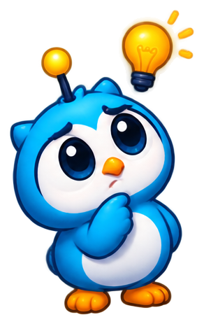 | **`boli-piensa`** Bolí pensando con una bombilla encendida `boli` `bombilla` `estilo-sticker` `idea` `pensar` | — | 4★ |
| 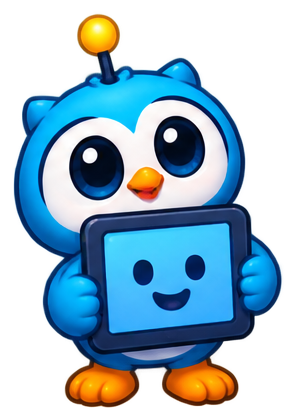 | **`boli-tablet`** Bolí sosteniendo una tablet con carita sonriente `boli` `estilo-sticker` `tablet` `tecnologia` | — | 4★ |
| 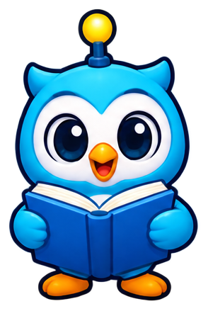 | **`boli-v2-libro`** Bolí (versión 2) leyendo un libro azul `boli` `boli-v2` `estilo-sticker` `lectura` `leer` `libro` | — | 4★ |
| 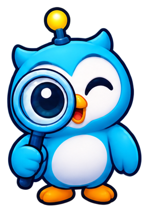 | **`boli-v2-lupa`** Bolí (versión 2) mirando por una lupa grande `boli` `boli-v2` `estilo-sticker` `investigar` `lupa` | — | 4★ |
| 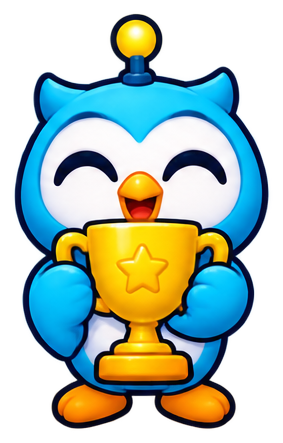 | **`boli-v2-trofeo`** Bolí (versión 2) con un trofeo dorado con estrella `boli` `boli-v2` `estilo-sticker` `premio` `trofeo` | — | 4★ |
