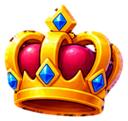
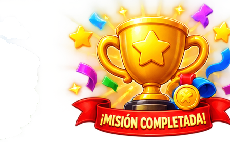
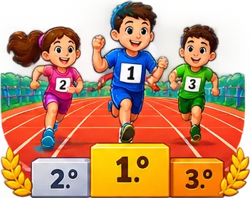

# premios

14 imágenes · [← volver al índice](../CATALOGO.md)

| Imagen | Id y qué contiene | Materia · grado | Calidad |
|:--:|---|---|:--:|
|  | **`aria-con-birrete-y-diploma-pergamino-subi-289a`** ARIA con birrete y diploma, pergamino «¡Subí de grado!» y cohete `4°` `5°` `aria` `celebracion` `diploma` `graduacion` `subir-de-grado` | tecnologia · grado 4, 5 | 5★ |
|  | **`aria-con-birrete-y-diploma-pergamino-subi-7fd8`** ARIA con birrete y diploma, pergamino «¡Subí de grado!» y cohete `4°` `aria` `aritmetica` `celebracion` `diploma` `graduacion` `subir-de-grado` | aritmetica · grado 4 | 5★ |
|  | **`aria-con-cohete-y-pergamino-subi-a-sexto-3ec5`** ARIA con cohete y pergamino «¡Subí a sexto!» `5°` `aria` `aritmetica` `celebracion` `quinto` `sexto` `subir-de-grado` | aritmetica · grado 5 | 5★ |
|  | **`corona`** Corona dorada con rubíes `corona` `campeón` `nivel máximo` `premio` `logro` | — | 5★ |
|  | **`icono-trofeo-dorado`** Trofeo dorado con estrella sobre base azul `estilo-sticker` `ganador` `logro` `premio` `trofeo` | — | 5★ |
|  | **`medalla-bronce`** Medalla de bronce con laurel `medalla` `logro` `bronce` `nivel` `premio` | — | 5★ |
|  | **`medalla-oro`** Medalla de oro con alas `medalla` `logro` `oro` `nivel` `premio` | — | 5★ |
|  | **`medalla-plata`** Medalla de plata con alas `medalla` `logro` `plata` `nivel` `premio` | — | 5★ |
|  | **`trofeo`** Trofeo dorado con estrella `trofeo` `campeón` `logro final` `premio` `logro` | — | 5★ |
|  | **`boleto-dorado-grande-con-el-precio-3-7-6931`** Boleto dorado grande con el precio «$3,7» `4°` `aritmetica` `boleto` `decimales` `dorado` `precio` | aritmetica · grado 4 | 4★ |
|  | **`img-956e498b9a`**  `4°` `logro` `personaje` `sprite` `tecnologia` `trofeo` | — | 4★ ✂ |
|  | **`podio-1-2-3-con-tres-ninos-corredores-en-u-cfbc`** Podio 1.º 2.º 3.º con tres niños corredores en una pista de atletismo `4°` `aritmetica` `atletismo` `carrera` `ordenar` `podio` `puestos` | aritmetica · grado 4 | 4★ |
|  | **`trofeo-dorado-con-estrella-y-ramas-de-laur-555c`** Trofeo dorado con estrella y ramas de laurel `4°` `5°` `aritmetica` `ganador` `logro` `tecnologia` `trofeo` | aritmetica, tecnologia · grado 4, 5 | 4★ |
|  | **`img-498e03792a`**  `4°` `aritmetica` `icono` `juego` `logro` `trofeo` | — | 3★ |
