# tematicos/decimales

47 imágenes · [← volver al índice](../CATALOGO.md)

| Imagen | Id y qué contiene | Materia · grado | Calidad |
|:--:|---|---|:--:|
| 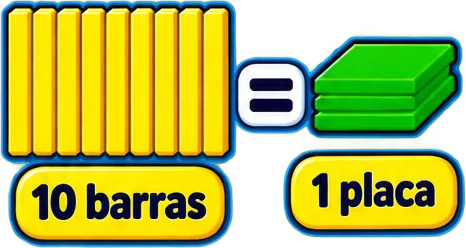 | **`10-barras-amarillas-de-decena-igual-a-1-pl-c867`** 10 barras amarillas de decena igual a 1 placa verde de centena (bloques de base 10) `4°` `aritmetica` `base10` `bloques` `centena` `decena` `decimales` | aritmetica · grado 4 | 5★ |
| 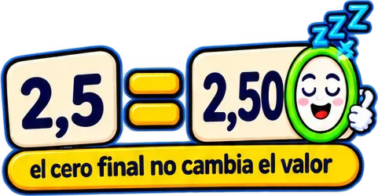 | **`2-5-2-50-con-un-0-final-que-duerme-el-cero-d864`** «2,5 = 2,50» con un 0 final que duerme: el cero final no cambia el valor `4°` `aritmetica` `cero-final` `decimales` `equivalencia` `igual` | aritmetica · grado 4 | 5★ |
| 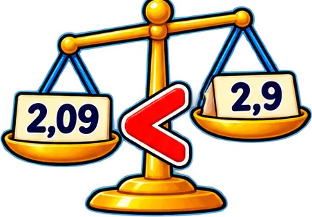 | **`balanza-de-platillos-que-compara-2-09-2-9-0ba9`** Balanza de platillos que compara 2,09 &lt; 2,9 `5°` `aritmetica` `balanza` `comparar` `decimales` `menor-que` | aritmetica · grado 5 | 5★ |
| 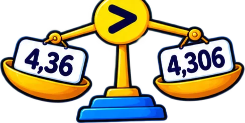 | **`balanza-de-platillos-que-compara-4-36-4-30-8ca0`** Balanza de platillos que compara 4,36 &gt; 4,306 `4°` `aritmetica` `balanza` `comparar` `decimales` `mayor-que` | aritmetica · grado 4 | 5★ |
| 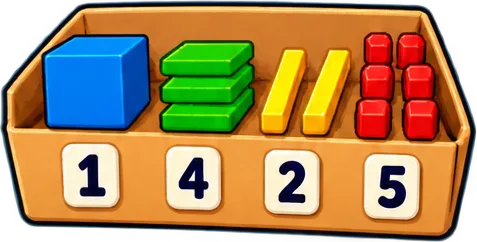 | **`bandeja-con-bloques-de-base-10-cubo-barras-aab6`** Bandeja con bloques de base 10 (cubo, barras y cubitos) y fichas de número 1 · 4 · 2 · 5 `4°` `aritmetica` `base10` `bloques` `decimales` `piezas` `valor-posicional` | aritmetica · grado 4 | 5★ |
|  | **`cartel-dorado-7-38-siete-enteros-con-trein-2040`** Cartel dorado «$7,38 — siete enteros con treinta y ocho centésimas» `5°` `7,38` `aritmetica` `cifras` `decimales` `escritura` `lectura` | aritmetica · grado 5 | 5★ |
| 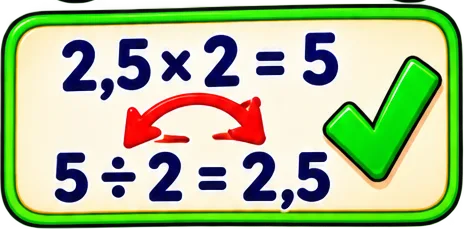 | **`comprobacion-2-5-2-5-y-5-2-2-5-con-una-pal-3884`** Comprobación «2,5 × 2 = 5» y «5 ÷ 2 = 2,5» con una palomita verde `5°` `aritmetica` `comprobar` `decimales` `division` `inversa` `multiplicacion` | aritmetica · grado 5 | 5★ |
| 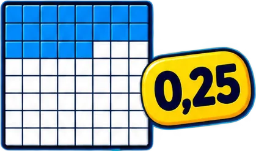 | **`cuadricula-de-100-cuadros-con-25-pintados-94da`** Cuadrícula de 100 cuadros con 25 pintados y el decimal 0,25 `0,25` `4°` `aritmetica` `centesimas` `cuadricula` `decimales` `representacion` | aritmetica · grado 4 | 5★ |
| 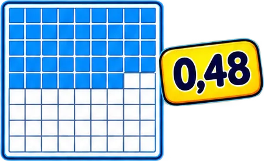 | **`cuadricula-de-100-cuadros-con-48-pintados-4c38`** Cuadrícula de 100 cuadros con 48 pintados y el decimal 0,48 `0,48` `5°` `aritmetica` `centesimas` `cuadricula` `decimales` `representacion` | aritmetica · grado 5 | 5★ |
| 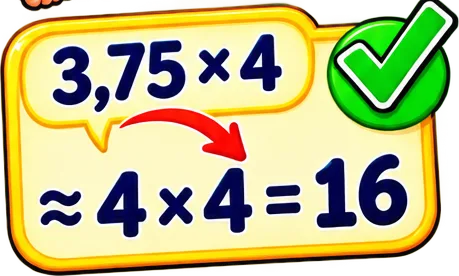 | **`estimacion-3-75-4-4-4-16-con-una-palomita-2625`** Estimación «3,75 × 4 ≈ 4 × 4 = 16» con una palomita verde `5°` `aritmetica` `decimales` `estimar` `multiplicacion` `redondear` | aritmetica · grado 5 | 5★ |
| 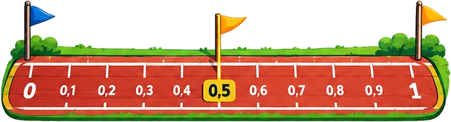 | **`img-0cc7535c7f`**  `4°` `aritmetica` `decimales` `numeros` `personaje` `sprite` | — | 5★ ✂ |
| 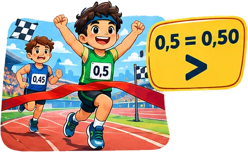 | **`img-516bd53260`**   texto: 0,50 `4°` `aritmetica` `decimales` `numeros` `tema` | — | 5★ ✂ |
|  | **`img-590a4b7a45`**  `5°` `aritmetica` `decimales` `numeros` `personaje` `sprite` | — | 5★ |
| 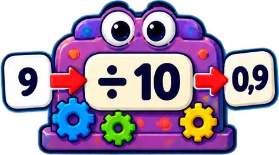 | **`maquina-con-engranajes-que-divide-entre-10-f7f3`** Máquina con engranajes que divide entre 10: 9 → 0,9 `4°` `aritmetica` `decimales` `dividir` `maquina` `patron` `x10` | aritmetica · grado 4 | 5★ |
| 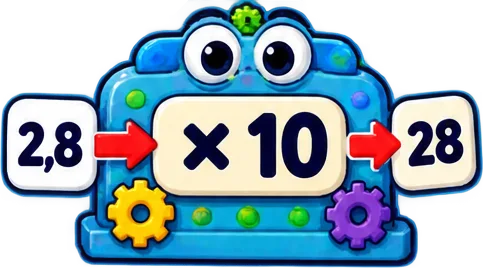 | **`maquina-con-engranajes-que-multiplica-por-bd55`** Máquina con engranajes que multiplica por 10: 2,8 → 28 `4°` `aritmetica` `decimales` `maquina` `multiplicar` `patron` `x10` | aritmetica · grado 4 | 5★ |
| 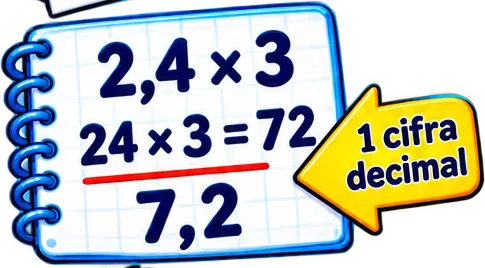 | **`multiplicacion-en-el-cuaderno-2-4-3-24-3-7-1067`** Multiplicación en el cuaderno 2,4 × 3 → 24 × 3 = 72 → 7,2 con «1 cifra decimal» `5°` `aritmetica` `cifras-decimales` `cuaderno` `decimales` `multiplicacion` `procedimiento` | aritmetica · grado 5 | 5★ |
|  | **`nina-con-una-laptop-y-aria-que-muestra-dec-a69a`** Niña con una laptop y ARIA que muestra «decimales en la vida real» `4°` `aria` `aritmetica` `buscar` `decimales` `vida-real` | aritmetica · grado 4 | 5★ |
| 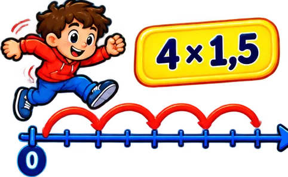 | **`nino-saltando-sobre-la-recta-numerica-con-3ec0`** Niño saltando sobre la recta numérica con «4 × 1,5» (saltos iguales) `5°` `aritmetica` `decimales` `multiplicacion` `recta-numerica` `saltos` | aritmetica · grado 5 | 5★ |
| 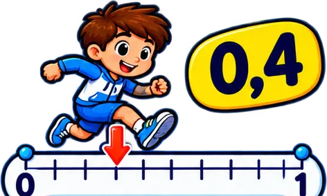 | **`nino-saltando-sobre-la-recta-numerica-de-0-8ffe`** Niño saltando sobre la recta numérica de 0 a 1 con la marca en 0,4 `0,4` `4°` `aritmetica` `decimales` `recta-numerica` `ubicar` | aritmetica · grado 4 | 5★ |
|  | **`nino-saltando-sobre-la-recta-numerica-de-0-e3fb`** Niño saltando sobre la recta numérica de 0 a 1 con la marca en 0,6 `0,6` `5°` `aritmetica` `decimales` `recta-numerica` `ubicar` | aritmetica · grado 5 | 5★ |
|  | **`personaje-coma-que-se-mueve-de-3-5-a-35-co-06f8`** Personaje «coma» que se mueve de 3,5 a 35 con el globo «la coma se mueve» `4°` `aritmetica` `coma` `decimales` `mover-coma` `multiplicar` `x10` | aritmetica · grado 4 | 5★ |
| 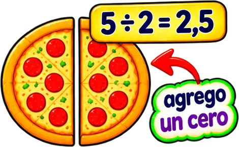 | **`pizza-partida-en-dos-con-5-2-2-5-y-la-nota-cfb0`** Pizza partida en dos con «5 ÷ 2 = 2,5» y la nota «agrego un cero» `5°` `agregar-cero` `aritmetica` `decimal` `decimales` `division` `pizza` | aritmetica · grado 5 | 5★ |
| 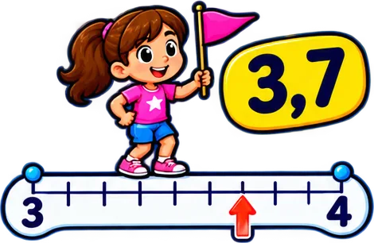 | **`recta-numerica-de-3-a-4-con-una-nina-con-b-878b`** Recta numérica de 3 a 4 con una niña con bandera que marca 3,7 `3,7` `4°` `aritmetica` `decimales` `recta-numerica` `ubicar` | aritmetica · grado 4 | 5★ |
| 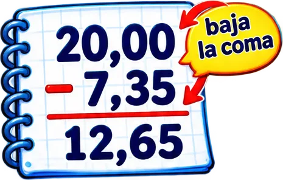 | **`resta-en-el-cuaderno-20-00-7-35-12-65-con-77eb`** Resta en el cuaderno 20,00 − 7,35 = 12,65 con «baja la coma» `5°` `algoritmo` `aritmetica` `coma` `cuaderno` `decimales` `resta` | aritmetica · grado 5 | 5★ |
| 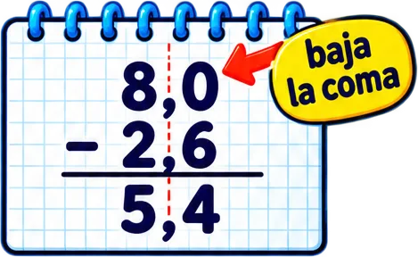 | **`resta-en-el-cuaderno-8-0-2-6-5-4-con-la-no-4f0f`** Resta en el cuaderno 8,0 − 2,6 = 5,4 con la nota «baja la coma» `4°` `algoritmo` `aritmetica` `coma` `cuaderno` `decimales` `resta` | aritmetica · grado 4 | 5★ |
| 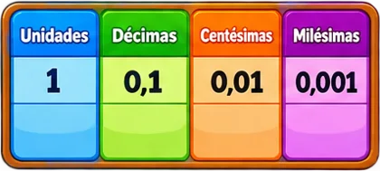 | **`tabla-de-valor-posicional-unidades-1-decim-b41e`** Tabla de valor posicional: Unidades 1 · Décimas 0,1 · Centésimas 0,01 · Milésimas 0,001 `4°` `aritmetica` `centesimas` `decimales` `decimas` `milesimas` `tabla` | aritmetica · grado 4 | 5★ |
| 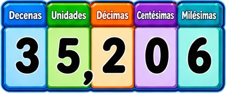 | **`tablero-de-valor-posicional-con-el-numero-453b`** Tablero de valor posicional con el número 35,206 (decenas a milésimas) `35,206` `5°` `aritmetica` `decimales` `lectura` `valor-posicional` | aritmetica · grado 5 | 5★ |
| 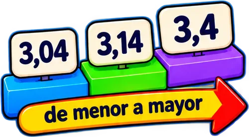 | **`tres-tarjetas-3-04-3-14-3-4-con-una-flecha-3cb9`** Tres tarjetas 3,04 · 3,14 · 3,4 con una flecha «de menor a mayor» `4°` `aritmetica` `comparar` `decimales` `menor-a-mayor` `ordenar` | aritmetica · grado 4 | 5★ |
| 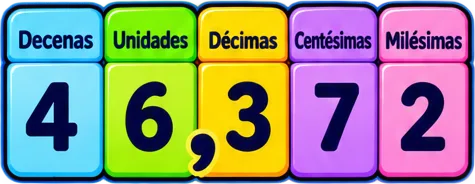 | **`valor-posicional-del-numero-46-372-con-dec-cd99`** Valor posicional del número 46,372 con decenas, unidades, décimas, centésimas y milésimas `46,372` `4°` `aritmetica` `decimales` `lectura` `valor-posicional` | aritmetica · grado 4 | 5★ |
| 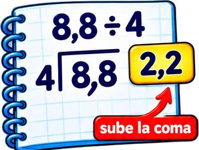 | **`division-en-el-cuaderno-8-8-4-2-2-con-sube-1894`** División en el cuaderno 8,8 ÷ 4 = 2,2 con «sube la coma» `5°` `algoritmo` `aritmetica` `coma` `cuaderno` `decimales` `division` | aritmetica · grado 5 | 4★ |
| 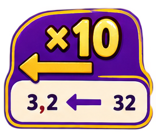 | **`img-0f7a4a9c92`**  `4°` `aritmetica` `decimales` `numeros` `tema` | — | 4★ |
| 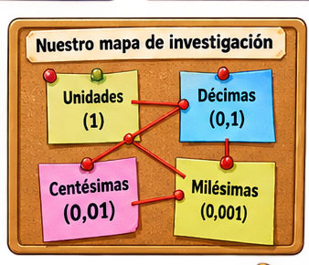 | **`img-1e260a517c`**  `4°` `aritmetica` `decimales` `numeros` `tema` | — | 4★ |
| 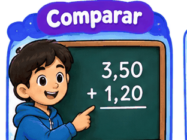 | **`img-36fbfedd9b`**   texto: 3,50 `5°` `aritmetica` `decimales` `numeros` `tema` | — | 4★ |
| 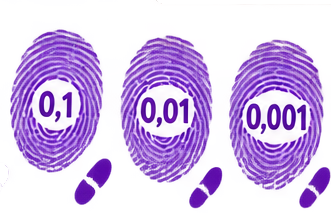 | **`img-3729f46b32`**  `4°` `aritmetica` `decimales` `numeros` `personaje` `sprite` | — | 4★ |
| 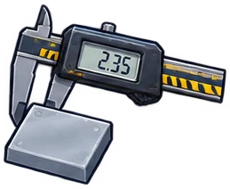 | **`img-6e3399908a`**  `4°` `aritmetica` `decimales` `icono` `juego` `numeros` | — | 4★ |
|  | **`img-74fa1717f9`**  `4°` `aritmetica` `decimales` `numeros` `tema` | — | 4★ ✂ |
| 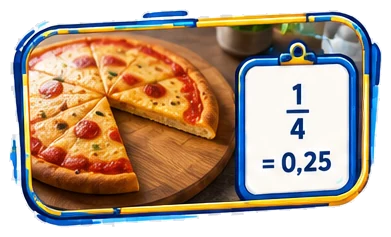 | **`img-8995c501b5`**  `5°` `aritmetica` `decimales` `numeros` `tema` | — | 4★ |
| 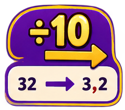 | **`img-9d389b138d`**  `4°` `aritmetica` `decimales` `numeros` `tema` | — | 4★ |
| 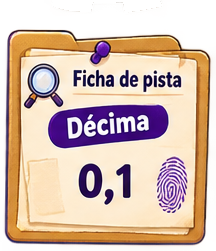 | **`img-c160823ca3`**   texto: pis `4°` `aritmetica` `decimales` `numeros` `tema` | — | 4★ |
| 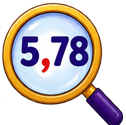 | **`img-c23b49b1c9`**  `4°` `aritmetica` `decimales` `icono` `juego` `numeros` | — | 4★ |
| 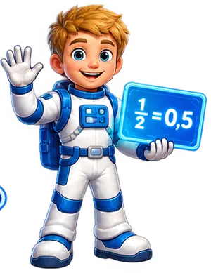 | **`img-cedb4c1ab9`**  `5°` `aritmetica` `decimales` `numeros` `personaje` `sprite` | — | 4★ |
|  | **`img-e1a8887404`**  `4°` `aritmetica` `decimales` `icono` `juego` `numeros` | — | 4★ |
| 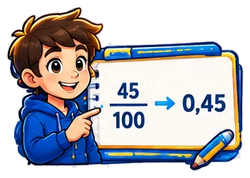 | **`img-e40b4531cb`**   texto: 100 `5°` `aritmetica` `decimales` `numeros` `personaje` `sprite` | — | 4★ |
| 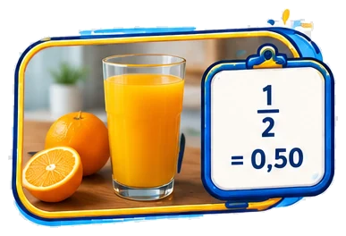 | **`img-f2193e0d36`**  `5°` `aritmetica` `decimales` `numeros` `personaje` `sprite` | — | 4★ |
| 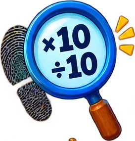 | **`lupa-grande-con-huellas-y-la-regla-10-10-d-766a`** Lupa grande con huellas y la regla «×10 ÷10» (detective del patrón decimal) `4°` `aritmetica` `decimales` `detective` `dividir10` `lupa` `multiplicar` | aritmetica · grado 4 | 4★ |
| 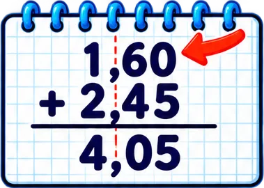 | **`suma-en-columna-1-60-2-45-4-05-en-el-cuade-0604`** Suma en columna 1,60 + 2,45 = 4,05 en el cuaderno con flecha en la coma `4°` `algoritmo` `aritmetica` `columna` `coma` `cuaderno` `decimales` | aritmetica · grado 4 | 4★ |
| 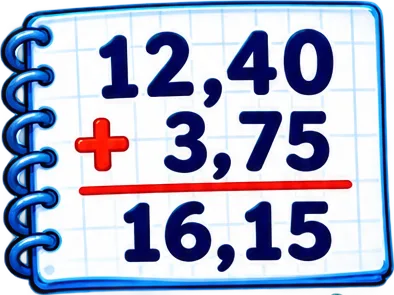 | **`suma-en-el-cuaderno-12-40-3-75-16-15-79ee`** Suma en el cuaderno 12,40 + 3,75 = 16,15 `5°` `algoritmo` `aritmetica` `coma` `cuaderno` `decimales` `suma` | aritmetica · grado 5 | 4★ |
