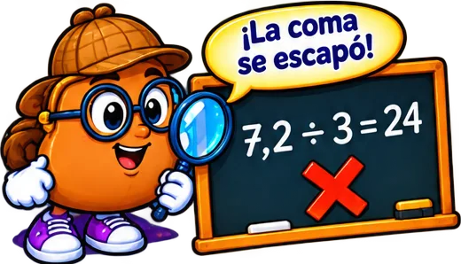
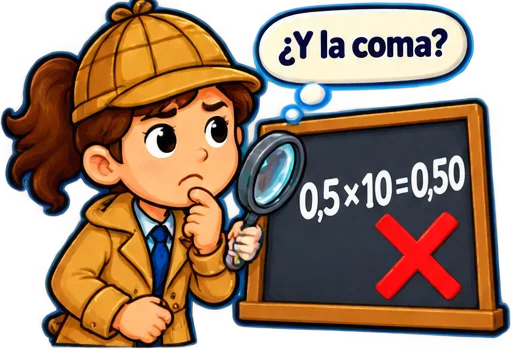
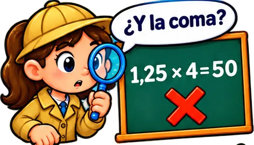
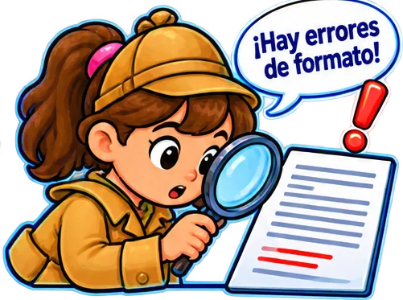
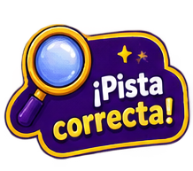
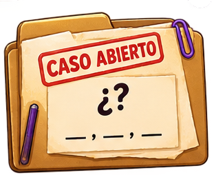

# tematicos/detectives

8 imágenes · [← volver al índice](../CATALOGO.md)

| Imagen | Id y qué contiene | Materia · grado | Calidad |
|:--:|---|---|:--:|
|  | **`detective-con-forma-de-papa-y-lupa-frente-c190`** Detective con forma de papa y lupa frente a la pizarra «7,2 ÷ 3 = 24» con X y «¡La coma se escapó!» `5°` `aritmetica` `coma` `detective` `detectives` `division` `error` | aritmetica · grado 5 | 5★ |
|  | **`detective-nina-con-lupa-frente-a-la-pizarr-2f69`** Detective niña con lupa frente a la pizarra «0,5×10=0,50» marcada con una X y la pregunta «¿Y la coma?» `4°` `aritmetica` `coma` `detective` `detectives` `error` `x10` | aritmetica · grado 4 | 5★ |
|  | **`detective-nina-con-lupa-frente-a-la-pizarr-d770`** Detective niña con lupa frente a la pizarra «1,25 × 4 = 50» marcada con X y «¿Y la coma?» `5°` `aritmetica` `coma` `detective` `detectives` `error` `multiplicar` | aritmetica · grado 5 | 5★ |
|  | **`detective-nina-con-lupa-sobre-un-documento-6bc4`** Detective niña con lupa sobre un documento: «¡Hay errores de formato!» `4°` `detective` `detectives` `documento` `errores` `formato` `revisar` | tecnologia · grado 4 | 5★ |
|  | **`diploma-con-una-lupa-y-la-pregunta-que-est-8a00`** Diploma con una lupa y la pregunta «¿Qué está mal?» `4°` `detective` `detectives` `diploma` `errores` `formato` `revisar` | tecnologia · grado 4 | 5★ |
|  | **`img-2e89e48086`**  `4°` `aritmetica` `detective` `icono` `juego` `lupa` `pista` | — | 4★ ✂ |
|  | **`img-9808acde86`**  `4°` `aritmetica` `detective` `icono` `juego` `lupa` `pista` | — | 4★ |
|  | **`img-ff7acb8878`**  `4°` `aritmetica` `detective` `lupa` `pista` `tema` | — | 4★ |
