# tematicos/dinero

29 imágenes · [← volver al índice](../CATALOGO.md)

| Imagen | Id y qué contiene | Materia · grado | Calidad |
|:--:|---|---|:--:|
| 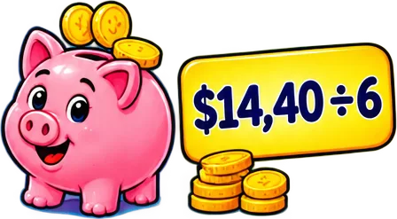 | **`alcancia-de-cerdito-con-monedas-y-14-40-6-953c`** Alcancía de cerdito con monedas y «$14,40 ÷ 6» `5°` `alcancia` `aritmetica` `decimales` `dinero` `division` `reparto` | aritmetica · grado 5 | 5★ |
|  | **`billete-y-monedas-con-compra-5-65-y-vuelto-8250`** Billete y monedas con «Compra: $5,65» y «Vuelto: $4,35» `5°` `aritmetica` `billete` `decimales` `dinero` `monedas` `resta` | aritmetica · grado 5 | 5★ |
|  | **`bus-escolar-con-cuatro-ninos-y-18-40-entre-a7a2`** Bus escolar con cuatro niños y «$18,40 entre 4» `5°` `aritmetica` `bus` `decimales` `dinero` `division` `reparto` | aritmetica · grado 5 | 5★ |
| 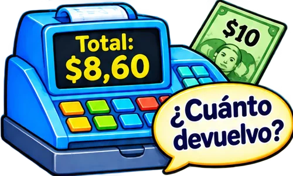 | **`caja-registradora-con-total-8-60-un-billet-5ac8`** Caja registradora con «Total: $8,60», un billete de $10 y «¿Cuánto devuelvo?» `5°` `aritmetica` `caja` `decimales` `dinero` `resta` `vuelto` | aritmetica · grado 5 | 5★ |
| 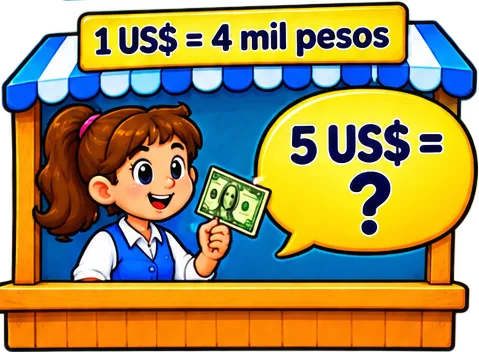 | **`casa-de-cambio-1-us-4-mil-pesos-y-la-pregu-a71a`** Casa de cambio «1 US$ = 4 mil pesos» y la pregunta «5 US$ = ?» `5°` `aritmetica` `cambio-moneda` `dinero` `dolares` `pesos` `proporcion` | aritmetica · grado 5 | 5★ |
|  | **`escalera-de-precios-1-05-1-25-1-5-con-flec-6a9f`** Escalera de precios $1,05 · $1,25 · $1,5 con flecha «de menor a mayor» `5°` `aritmetica` `decimales` `dinero` `menor-a-mayor` `ordenar` `precios` | aritmetica · grado 5 | 5★ |
|  | **`img-0550365a60`**  `5°` `aritmetica` `dinero` `precios` `tema` `tienda` | — | 5★ |
| 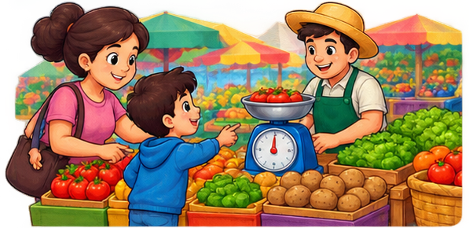 | **`img-42fe53aa6c`**  `5°` `aritmetica` `dinero` `precios` `tema` `tienda` | — | 5★ |
| 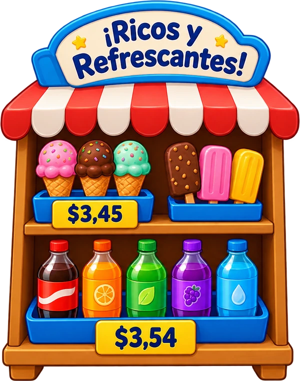 | **`img-604d788761`**  `5°` `aritmetica` `dinero` `precios` `tema` `tienda` | — | 5★ |
|  | **`img-d3669ff3f5`**  `5°` `aritmetica` `dinero` `precios` `tienda` `ui` | — | 5★ |
| 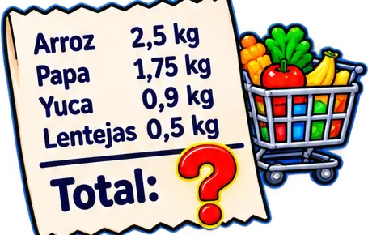 | **`lista-de-compras-arroz-2-5-kg-papa-1-75-kg-ad48`** Lista de compras (arroz 2,5 kg, papa 1,75 kg, yuca 0,9 kg, lentejas 0,5 kg) con «Total: ?» y un carrito `4°` `aritmetica` `compras` `decimales` `dinero` `plaza` `problema` | aritmetica · grado 4 | 5★ |
| 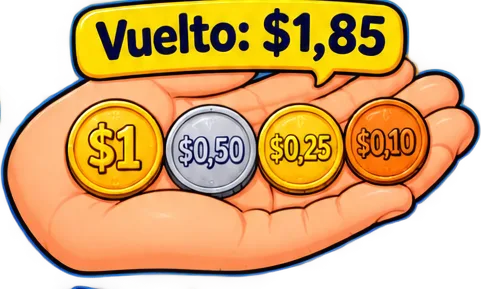 | **`mano-con-monedas-y-el-letrero-vuelto-1-85-63ba`** Mano con monedas y el letrero «Vuelto: $1,85» `4°` `aritmetica` `dinero` `monedas` `resta` `vuelto` | aritmetica · grado 4 | 5★ |
|  | **`nino-con-un-helado-2-30-una-galleta-0-85-y-eaa2`** Niño con un helado ($2,30), una galleta ($0,85) y un billete de $5 `4°` `aritmetica` `billete` `compra` `decimales` `dinero` `galleta` | aritmetica · grado 4 | 5★ |
|  | **`nino-tendero-con-vuelto-compra-5-65-y-pago-eb62`** Niño tendero con «Vuelto: $?», compra $5,65 y pagó $10 `5°` `aritmetica` `decimales` `dinero` `problema` `resta` `vuelto` | aritmetica · grado 5 | 5★ |
| 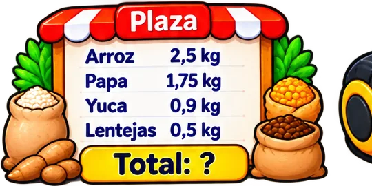 | **`puesto-plaza-con-lista-arroz-2-5-kg-papa-1-3137`** Puesto «Plaza» con lista arroz 2,5 kg, papa 1,75 kg, yuca 0,9 kg, lentejas 0,5 kg y «Total: ?» `5°` `aritmetica` `compras` `decimales` `dinero` `mercado` `plaza` | aritmetica · grado 5 | 5★ |
| 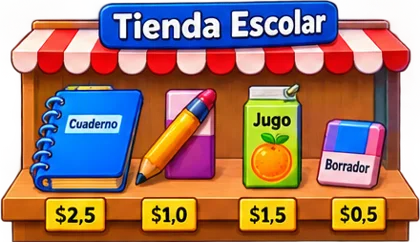 | **`puesto-tienda-escolar-con-cuaderno-lapiz-j-7e71`** Puesto «Tienda Escolar» con cuaderno, lápiz, jugo y borrador, con precios $2,5 $1,0 $1,5 $0,5 `4°` `aritmetica` `compra` `decimales` `dinero` `escuela` `precios` | aritmetica · grado 4 | 5★ |
| 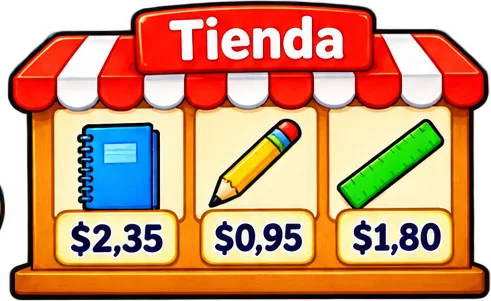 | **`tienda-con-cuaderno-2-35-lapiz-0-95-y-regl-db28`** Tienda con cuaderno $2,35, lápiz $0,95 y regla $1,80 `5°` `aritmetica` `decimales` `dinero` `precios` `resta` `suma` | aritmetica · grado 5 | 5★ |
| 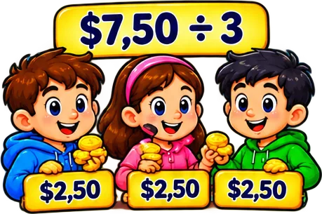 | **`tres-ninos-que-reparten-7-50-3-y-reciben-2-437a`** Tres niños que reparten «$7,50 ÷ 3» y reciben $2,50 cada uno `5°` `aritmetica` `decimales` `dinero` `division` `reparto` | aritmetica · grado 5 | 5★ |
| 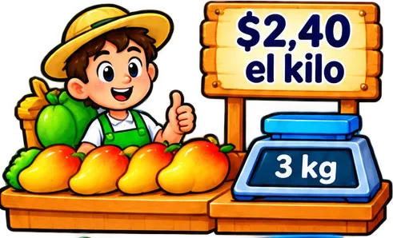 | **`vendedor-de-frutas-con-el-letrero-2-40-el-85c6`** Vendedor de frutas con el letrero «$2,40 el kilo» y una balanza que marca 3 kg `5°` `aritmetica` `decimales` `dinero` `frutas` `kilo` `mercado` | aritmetica · grado 5 | 5★ |
| 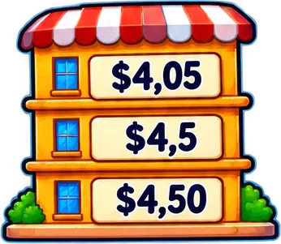 | **`edificio-de-tres-pisos-con-los-precios-4-0-a0cc`** Edificio de tres pisos con los precios $4,05 · $4,5 · $4,50 (comparar y ordenar) `5°` `aritmetica` `comparar` `decimales` `dinero` `equivalencia` `precios` | aritmetica · grado 5 | 4★ |
| 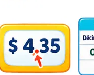 | **`img-0639eddbc1`**  `5°` `aritmetica` `dinero` `precios` `tema` `tienda` | — | 4★ |
|  | **`img-34b3e02b4b`**  `5°` `aritmetica` `dinero` `personaje` `precios` `sprite` `tienda` | — | 4★ |
|  | **`img-5e0bbb98fe`**  `5°` `aritmetica` `dinero` `precios` `tema` `tienda` | — | 4★ |
|  | **`img-61bad75756`**   texto: (250) `4°` `aritmetica` `dinero` `personaje` `precios` `sprite` `tienda` | — | 4★ |
|  | **`img-6ba5a1f508`**  `5°` `aritmetica` `dinero` `personaje` `precios` `sprite` `tienda` | — | 4★ |
| 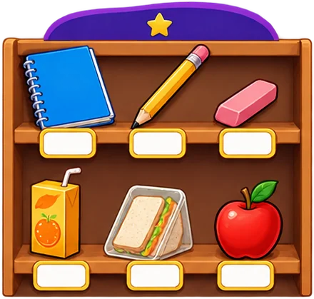 | **`img-8fbaeb4b4b`**  `5°` `aritmetica` `dinero` `precios` `tema` `tienda` | — | 4★ |
|  | **`img-a7862dd7e1`**  `5°` `aritmetica` `dinero` `precios` `tema` `tienda` | — | 4★ |
| 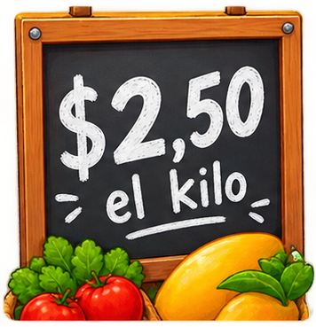 | **`img-b71d08f8fb`**   texto: 2,50 `5°` `aritmetica` `dinero` `precios` `tema` `tienda` | — | 4★ |
| 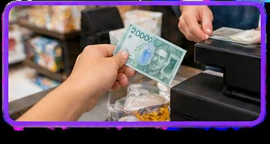 | **`img-f60fcd2455`**  `5°` `aritmetica` `dinero` `precios` `tema` `tienda` | — | 4★ |
