# tematicos/documentos-word

18 imágenes · [← volver al índice](../CATALOGO.md)

| Imagen | Id y qué contiene | Materia · grado | Calidad |
|:--:|---|---|:--:|
|  | **`aria-con-lista-de-chequeo-letra-legible-ma-f41e`** ARIA con lista de chequeo: letra legible, márgenes, imagen proporcional y título centrado `4°` `aria` `documento` `documentos-word` `formato` `lista-chequeo` `revisar` | tecnologia · grado 4 | 5★ |
|  | **`aria-que-pulsa-insertar-tabla-3-4-sobre-un-fc50`** ARIA que pulsa «Insertar tabla 3 × 4» sobre una tabla azul `4°` `aria` `columnas` `documentos-word` `filas` `insertar` `tabla` | tecnologia · grado 4 | 5★ |
| 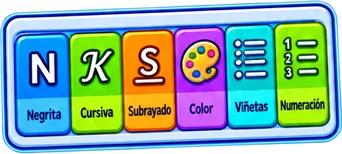 | **`barra-de-formato-con-iconos-negrita-cursiv-9e1e`** Barra de formato con iconos Negrita, Cursiva, Subrayado, Color, Viñetas y Numeración `4°` `color` `cursiva` `documentos-word` `formato` `negrita` `numeracion` | tecnologia · grado 4 | 5★ |
| 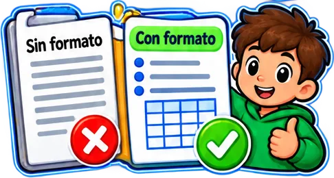 | **`comparacion-de-un-documento-sin-formato-x-2bc5`** Comparación de un documento «Sin formato» (X roja) y «Con formato» (palomita verde) con un niño `4°` `antes-despues` `documento` `documentos-word` `formato` `tecnologia` `texto` | tecnologia · grado 4 | 5★ |
| 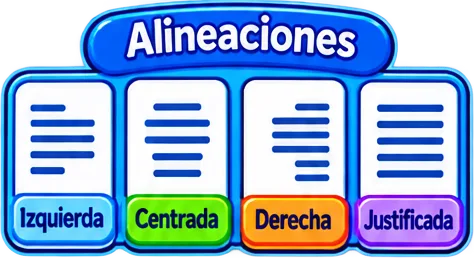 | **`cuatro-alineaciones-de-texto-izquierda-cen-7472`** Cuatro alineaciones de texto: izquierda, centrada, derecha y justificada `4°` `alineacion` `centrada` `derecha` `documentos-word` `izquierda` `justificada` | tecnologia · grado 4 | 5★ |
| 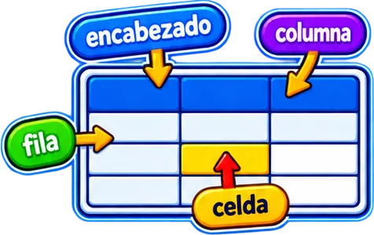 | **`diagrama-de-tabla-con-encabezado-columna-f-a03b`** Diagrama de tabla con encabezado, columna, fila y celda señalados `4°` `celda` `columna` `documentos-word` `encabezado` `fila` `partes` | tecnologia · grado 4 | 5★ |
| 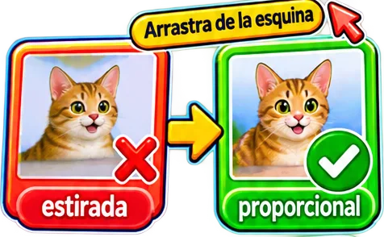 | **`dos-fotos-de-gato-estirada-x-y-proporciona-14c1`** Dos fotos de gato: «estirada» (X) y «proporcional» (palomita) con «Arrastra de la esquina» `4°` `ajustar` `documentos-word` `esquina` `imagen` `proporcional` `tamano` | tecnologia · grado 4 | 5★ |
| 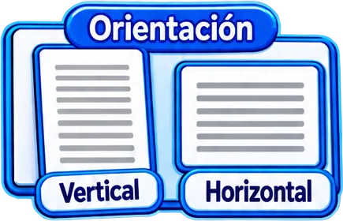 | **`dos-hojas-orientacion-vertical-y-horizonta-d065`** Dos hojas «Orientación»: vertical y horizontal `4°` `documento` `documentos-word` `horizontal` `orientacion` `pagina` `tecnologia` | tecnologia · grado 4 | 5★ |
| 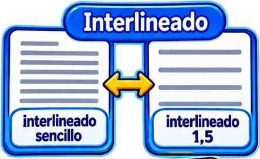 | **`dos-textos-interlineado-sencillo-y-1-5-f5c5`** Dos textos «Interlineado»: sencillo y 1,5 `4°` `documentos-word` `espacio` `formato` `interlineado` `tecnologia` `texto` | tecnologia · grado 4 | 5★ |
| 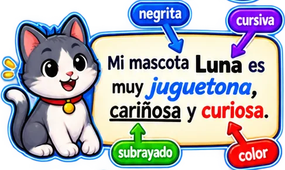 | **`gato-luna-con-un-parrafo-que-usa-negrita-c-11a9`** Gato Luna con un párrafo que usa negrita, cursiva, subrayado y color `4°` `color` `cursiva` `documentos-word` `ejemplo` `formato` `negrita` | tecnologia · grado 4 | 5★ |
| 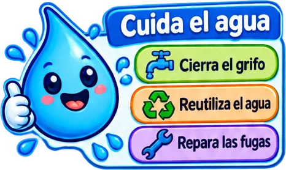 | **`gota-de-agua-con-el-cartel-cuida-el-agua-y-2c75`** Gota de agua con el cartel «Cuida el agua» y tres acciones (cierra el grifo, reutiliza, repara fugas) `4°` `agua` `documento` `documentos-word` `ejemplo` `lista` `tecnologia` | tecnologia · grado 4 | 5★ |
| 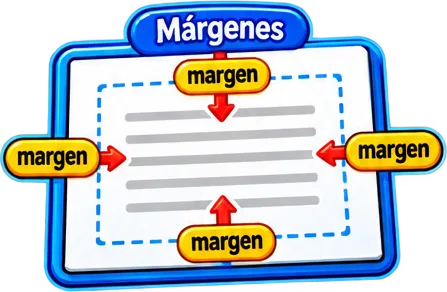 | **`hoja-con-margenes-senalados-superior-infer-0002`** Hoja con márgenes señalados (superior, inferior, izquierdo y derecho) `4°` `documento` `documentos-word` `formato` `margenes` `pagina` `tecnologia` | tecnologia · grado 4 | 5★ |
| 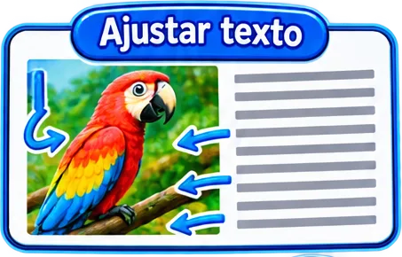 | **`imagen-de-un-loro-dentro-de-un-texto-con-f-f8bb`** Imagen de un loro dentro de un texto con flechas y el título «Ajustar texto» `4°` `ajustar` `ajuste` `documentos-word` `imagen` `tecnologia` `texto` | tecnologia · grado 4 | 5★ |
| 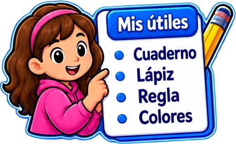 | **`nina-senalando-una-lista-mis-utiles-cuader-5980`** Niña señalando una lista «Mis útiles»: cuaderno, lápiz, regla, colores `4°` `documento` `documentos-word` `ejemplo` `lista` `tecnologia` `utiles` | tecnologia · grado 4 | 5★ |
|  | **`nino-frente-a-una-laptop-con-una-tabla-en-a6da`** Niño frente a una laptop con una tabla en pantalla y el globo «¡Mi tabla!» `4°` `crear` `documento` `documentos-word` `tabla` `tecnologia` `word` | tecnologia · grado 4 | 5★ |
| 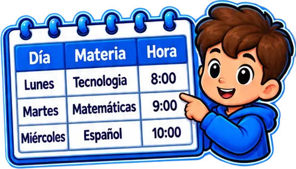 | **`nino-senalando-una-tabla-de-horario-dia-ma-0185`** Niño señalando una tabla de horario (día, materia, hora) `4°` `columnas` `documento` `documentos-word` `filas` `horario` `tabla` | tecnologia · grado 4 | 5★ |
| 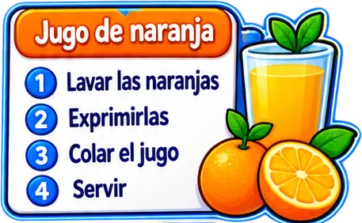 | **`receta-jugo-de-naranja-con-4-pasos-numerad-6842`** Receta «Jugo de naranja» con 4 pasos numerados (lavar, exprimir, colar y servir) y un vaso con jugo `4°` `documento` `documentos-word` `lista-numerada` `pasos` `receta` `tecnologia` | tecnologia · grado 4 | 5★ |
| 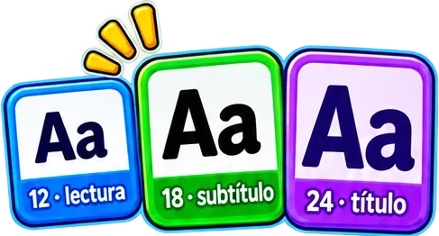 | **`tres-tamanos-de-letra-aa-12-lectura-18-sub-c974`** Tres tamaños de letra «Aa»: 12 lectura, 18 subtítulo y 24 título `4°` `documentos-word` `formato` `fuente` `subtitulo` `tamano-letra` `tecnologia` | tecnologia · grado 4 | 5★ |
