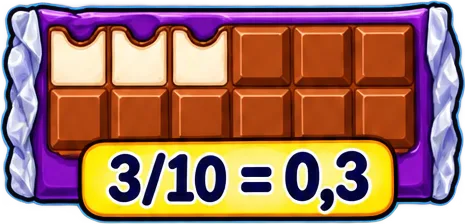
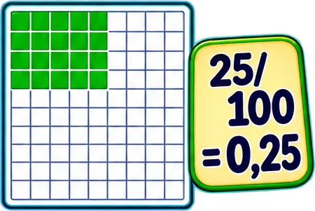
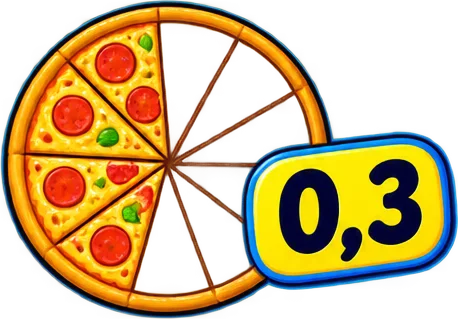
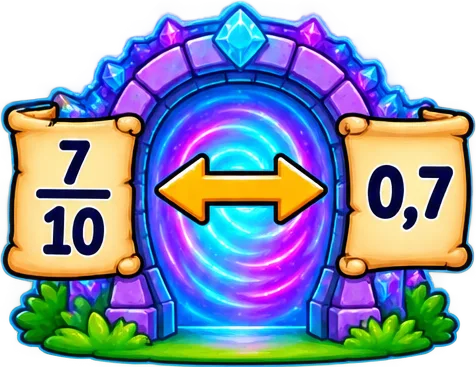

# tematicos/fracciones

4 imágenes · [← volver al índice](../CATALOGO.md)

| Imagen | Id y qué contiene | Materia · grado | Calidad |
|:--:|---|---|:--:|
|  | **`barra-de-chocolate-partida-en-10-con-3-10-052f`** Barra de chocolate partida en 10 con «3/10 = 0,3» `0,3` `3/10` `5°` `aritmetica` `chocolate` `fraccion-decimal` `fracciones` | aritmetica · grado 5 | 5★ |
|  | **`cuadricula-de-100-con-25-cuadros-verdes-y-9b09`** Cuadrícula de 100 con 25 cuadros verdes y «25/100 = 0,25» `0,25` `25/100` `5°` `aritmetica` `cuadricula` `fraccion-decimal` `fracciones` | aritmetica · grado 5 | 5★ |
|  | **`pizza-partida-en-10-con-el-decimal-0-3-sen-dbb2`** Pizza partida en 10 con el decimal 0,3 señalado `0,3` `4°` `aritmetica` `decimal` `fraccion` `fracciones` `pizza` | aritmetica · grado 4 | 5★ |
|  | **`portal-magico-con-la-fraccion-7-10-y-el-de-9bc3`** Portal mágico con la fracción 7/10 y el decimal 0,7 unidos por una flecha `0,7` `5°` `7/10` `aritmetica` `equivalencia` `fraccion-decimal` `fracciones` | aritmetica · grado 5 | 5★ |
