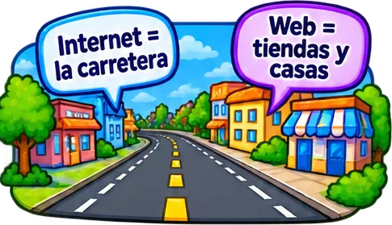
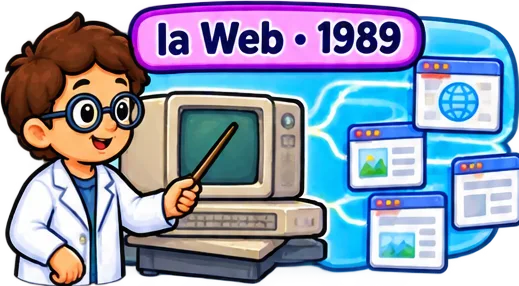
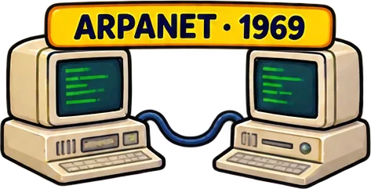
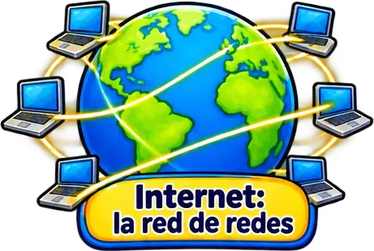
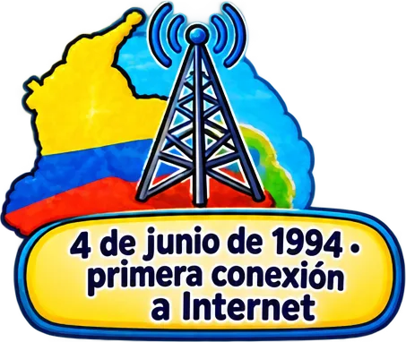
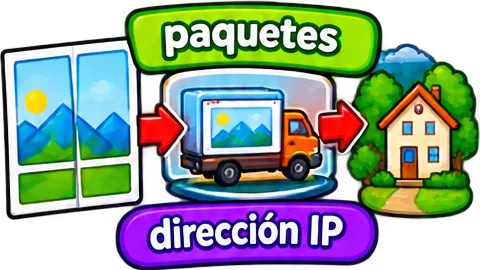

# tematicos/historia-internet

11 imágenes · [← volver al índice](../CATALOGO.md)

| Imagen | Id y qué contiene | Materia · grado | Calidad |
|:--:|---|---|:--:|
|  | **`calle-internet-la-carretera-y-web-tiendas-f674`** Calle: «Internet = la carretera» y «Web = tiendas y casas» `5°` `analogia` `carretera` `historia-internet` `internet-vs-web` `tecnologia` `tiendas` | tecnologia · grado 5 | 5★ |
|  | **`cientifico-senalando-una-computadora-y-pag-21b7`** Científico señalando una computadora y páginas web: «la Web · 1989» `1989` `5°` `berners-lee` `historia` `historia-internet` `paginas` `tecnologia` | tecnologia · grado 5 | 5★ |
|  | **`dos-computadoras-antiguas-conectadas-arpan-2a1c`** Dos computadoras antiguas conectadas: «ARPANET · 1969» `1969` `5°` `arpanet` `computadoras` `historia` `historia-internet` `red` | tecnologia · grado 5 | 5★ |
|  | **`dos-laptops-que-se-saludan-hola-y-hello-co-cd1f`** Dos laptops que se saludan «Hola» y «Hello» con el rótulo «TCP/IP · idioma común» `5°` `historia-internet` `idioma-comun` `protocolo` `redes` `tcp-ip` `tecnologia` | tecnologia · grado 5 | 5★ |
|  | **`globo-terraqueo-conectado-a-muchas-computa-f5ce`** Globo terráqueo conectado a muchas computadoras: «Internet: la red de redes» `5°` `computadoras` `definicion` `historia-internet` `internet` `mundo` `red-de-redes` | tecnologia · grado 5 | 5★ |
|  | **`los-pioneros-en-cuatro-medallas-hopper-com-fd45`** «Los pioneros» en cuatro medallas: Hopper (compilador), Feinler (dominios), Cerf y Kahn (TCP/IP), Tomlinson (correo) `5°` `cerf` `feinler` `historia` `historia-internet` `hopper` `kahn` | tecnologia · grado 5 | 5★ |
|  | **`mapa-de-colombia-con-una-torre-de-antena-4-d276`** Mapa de Colombia con una torre de antena: «4 de junio de 1994 · primera conexión a Internet» `1994` `5°` `colombia` `conexion` `historia` `historia-internet` `internet` | tecnologia · grado 5 | 5★ |
|  | **`mapa-del-mundo-con-computadoras-y-flechas-0f4d`** Mapa del mundo con computadoras y flechas rojas que se expanden: «Año 2000» `2000` `5°` `expansion` `historia` `historia-internet` `internet` `mundo` | tecnologia · grado 5 | 5★ |
|  | **`nino-con-microfono-entrevista-a-una-abuela-59ec`** Niño con micrófono entrevista a una abuela: «¿Cómo era sin Internet?» `5°` `abuela` `antes-del-internet` `entrevista` `historia` `historia-internet` `tecnologia` | tecnologia · grado 5 | 5★ |
|  | **`sobre-con-arroba-1971-primer-correo-c1d3`** Sobre con arroba: «1971 · primer correo» `1971` `5°` `arroba` `correo-electronico` `historia` `historia-internet` `tecnologia` | tecnologia · grado 5 | 5★ |
|  | **`una-foto-que-se-divide-en-paquetes-que-via-237e`** Una foto que se divide en «paquetes» que viajan en camión hasta una casa: «dirección IP» `5°` `como-viaja-informacion` `direccion-ip` `historia-internet` `paquetes` `redes` `tecnologia` | tecnologia · grado 5 | 5★ |
