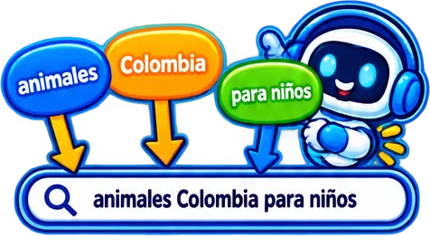
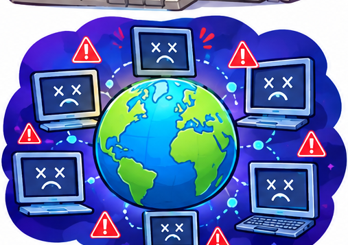
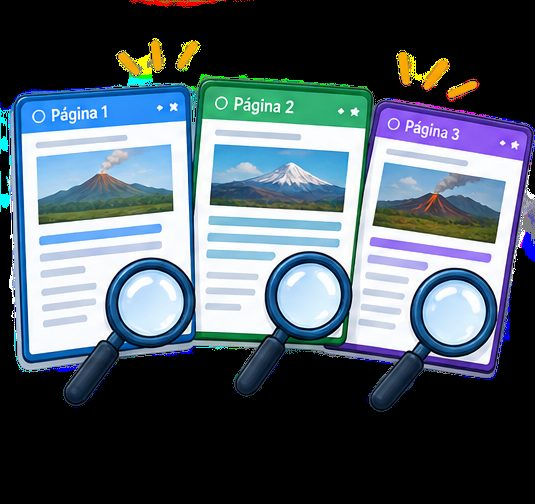
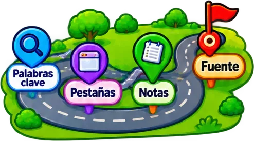
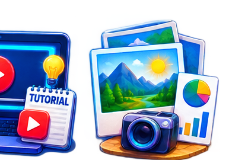

# tematicos/internet

32 imágenes · [← volver al índice](../CATALOGO.md)

| Imagen | Id y qué contiene | Materia · grado | Calidad |
|:--:|---|---|:--:|
|  | **`aria-con-lupa-sobre-un-libro-con-fuente-pa-680a`** ARIA con lupa sobre un libro con «Fuente: página del colegio» `4°` `aria` `citar` `fuente` `internet` `investigar` `libro` | tecnologia · grado 4 | 5★ |
|  | **`aria-con-un-planeta-y-cohete-frente-a-la-b-9708`** ARIA con un planeta y cohete frente a la búsqueda «planetas del sistema solar para niños» `4°` `aria` `buscador` `busqueda` `internet` `palabras-clave` `sistema-solar` | tecnologia · grado 4 | 5★ |
|  | **`aria-con-un-video-como-armar-una-maqueta-p-5b19`** ARIA con un video «Cómo armar una maqueta paso a paso» en una pantalla `5°` `aria` `internet` `tecnologia` `tipos-informacion` `tutorial` `video` | tecnologia · grado 5 | 5★ |
|  | **`banderines-de-dominios-com-tienda-edu-escu-5c7c`** Banderines de dominios: .com tienda, .edu escuela, .gov.co gobierno, .org organización `4°` `com` `dominios` `edu` `gov` `internet` `org` | tecnologia · grado 4 | 5★ |
|  | **`barra-de-busqueda-volcanes-activos-de-colo-f2ab`** Barra de búsqueda «volcanes activos de Colombia» con las palabras clave en burbujas `5°` `buscador` `busqueda` `colombia` `internet` `palabras-clave` `tecnologia` | tecnologia · grado 5 | 5★ |
|  | **`barra-de-direccion-url-direccion-completa-b718`** Barra de dirección: «URL = dirección completa» y «.gov.co = dominio» `4°` `direccion-web` `dominio` `gov` `internet` `tecnologia` `url` | tecnologia · grado 4 | 5★ |
|  | **`busqueda-animales-colombia-para-ninos-con-f443`** Búsqueda «animales Colombia para niños» con palabras clave señaladas y ARIA `4°` `aria` `buscador` `busqueda` `internet` `palabras-clave` `tecnologia` | tecnologia · grado 4 | 5★ |
|  | **`img-0ca0b55e74`**  `5°` `busqueda-web` `internet` `redes` `tecnologia` `tema` | — | 5★ |
|  | **`img-5774a15707`**  `5°` `busqueda-web` `internet` `redes` `tecnologia` `tema` | — | 5★ |
|  | **`img-785d3fdafb`**  `5°` `busqueda-web` `internet` `redes` `tecnologia` `tema` | — | 5★ |
|  | **`img-a66dc20f74`**  `5°` `busqueda-web` `internet` `redes` `tecnologia` `tema` | — | 5★ |
|  | **`img-aec75e67dd`**  `5°` `busqueda-web` `internet` `redes` `tecnologia` `tema` | — | 5★ |
|  | **`img-d8f2a2480e`**  `5°` `busqueda-web` `internet` `redes` `tecnologia` `tema` | — | 5★ |
|  | **`nina-con-lupa-ante-una-laptop-con-la-busqu-d598`** Niña con lupa ante una laptop con la búsqueda «noticias de Colombia hoy» `5°` `buscar` `busqueda` `internet` `investigar` `noticias` `tecnologia` | tecnologia · grado 5 | 5★ |
|  | **`nina-con-lupa-ante-una-laptop-que-muestra-978a`** Niña con lupa ante una laptop que muestra «animales en peligro de Colombia» con un jaguar `4°` `animales` `busqueda` `colombia` `internet` `investigar` `navegador` | tecnologia · grado 4 | 5★ |
|  | **`nina-con-lupa-y-aria-frente-a-una-laptop-q-5b72`** Niña con lupa y ARIA frente a una laptop que muestra la búsqueda «tasa de cambio hoy» `5°` `aria` `aritmetica` `buscar` `internet` `investigar` `tasa-cambio` | aritmetica · grado 5 | 5★ |
|  | **`ruta-de-investigacion-con-paradas-palabras-3516`** Ruta de investigación con paradas «Palabras clave», «Pestañas», «Notas» y «Fuente» `5°` `fuente` `internet` `investigacion` `notas` `palabras-clave` `pestanas` | tecnologia · grado 5 | 5★ |
|  | **`tarjetas-tipos-de-informacion-texto-imagen-28d1`** Tarjetas «Tipos de información»: texto, imagen, video, audio e infografía `4°` `audio` `imagen` `infografia` `internet` `tecnologia` `texto` | tecnologia · grado 4 | 5★ |
|  | **`ventana-de-navegador-con-tres-pestanas-pag-0de4`** Ventana de navegador con tres pestañas: Página 1, Página 2 y Página 3 `5°` `internet` `navegador` `paginas` `pestanas` `tecnologia` `ventana` | tecnologia · grado 5 | 5★ |
|  | **`ventanas-navegador-brujula-y-buscador-lupa-1804`** Ventanas «Navegador» (brújula) y «Buscador» (lupa) `4°` `buscador` `diferencia` `internet` `navegador` `tecnologia` | tecnologia · grado 4 | 5★ |
|  | **`img-1bb9982a45`**  `4°` `busqueda-web` `internet` `personaje` `redes` `sprite` `tecnologia` | — | 4★ ✂ |
|  | **`img-1fc303406d`**   texto: non `4°` `busqueda-web` `icono` `internet` `juego` `redes` `tecnologia` | — | 4★ ✂ |
|  | **`img-21261bbb28`**  `5°` `busqueda-web` `internet` `redes` `tecnologia` `tema` | — | 4★ |
|  | **`img-2268b3b168`**  `5°` `busqueda-web` `internet` `redes` `tecnologia` `tema` | — | 4★ ✂ |
|  | **`img-364e19bd78`**  `5°` `busqueda-web` `internet` `redes` `tecnologia` `tema` | — | 4★ |
|  | **`img-4ddf50bedd`**  `5°` `busqueda-web` `internet` `redes` `tecnologia` `tema` | — | 4★ |
|  | **`img-5a80c8c90f`**  `5°` `busqueda-web` `internet` `redes` `tecnologia` `tema` | — | 4★ |
|  | **`img-a140eb8aea`**  `4°` `busqueda-web` `internet` `redes` `tecnologia` `tema` | — | 4★ ✂ |
|  | **`img-a190712cce`**  `4°` `busqueda-web` `internet` `personaje` `redes` `sprite` `tecnologia` | — | 4★ ✂ |
|  | **`img-a2f65d034e`**  `4°` `busqueda-web` `internet` `redes` `tecnologia` `tema` | — | 4★ ✂ |
|  | **`img-a6f92bda85`**  `5°` `busqueda-web` `internet` `redes` `tecnologia` `tema` | — | 4★ |
|  | **`img-b62fb7e8f3`**  `4°` `busqueda-web` `internet` `redes` `tecnologia` `tema` | — | 4★ ✂ |
