# tematicos/medidas

11 imágenes · [← volver al índice](../CATALOGO.md)

| Imagen | Id y qué contiene | Materia · grado | Calidad |
|:--:|---|---|:--:|
| 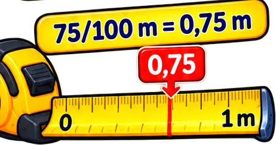 | **`cinta-metrica-de-0-a-1-m-con-75-100-m-0-75-91ca`** Cinta métrica de 0 a 1 m con «75/100 m = 0,75 m» y una flecha en 0,75 `0,75` `5°` `aritmetica` `fraccion-decimal` `longitud` `medidas` `metro` | aritmetica · grado 5 | 5★ |
| 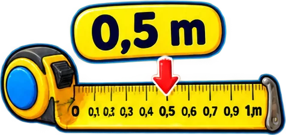 | **`cinta-metrica-extendida-con-una-flecha-en-113c`** Cinta métrica extendida con una flecha en 0,5 m `0,5` `4°` `aritmetica` `cinta-metrica` `decimales` `longitud` `medidas` | aritmetica · grado 4 | 5★ |
| 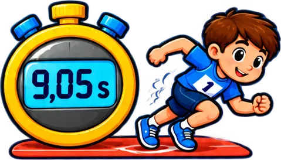 | **`cronometro-dorado-que-marca-9-05-s-junto-a-3f79`** Cronómetro dorado que marca 9,05 s junto a un niño corriendo `4°` `aritmetica` `carrera` `cronometro` `decimales` `medidas` `segundos` | aritmetica · grado 4 | 5★ |
| 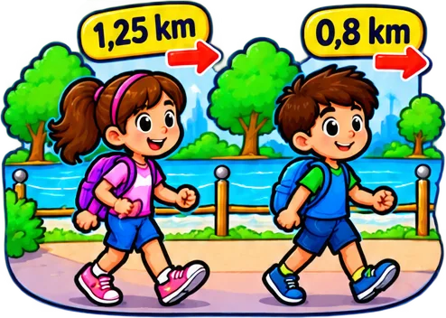 | **`dos-ninos-caminando-por-un-parque-con-dist-aeb5`** Dos niños caminando por un parque con distancias 1,25 km y 0,8 km `4°` `aritmetica` `caminar` `comparar` `decimales` `distancia` `kilometros` | aritmetica · grado 4 | 5★ |
| 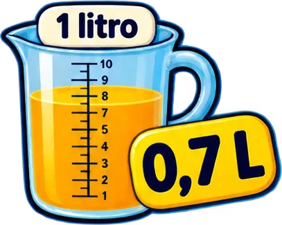 | **`jarra-medidora-de-1-litro-con-jugo-de-nara-cc7b`** Jarra medidora de 1 litro con jugo de naranja que llega a 0,7 L `4°` `aritmetica` `capacidad` `decimales` `jarra` `litros` `medidas` | aritmetica · grado 4 | 5★ |
| 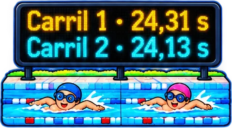 | **`marcador-de-natacion-carril-1-24-31-s-y-ca-94c0`** Marcador de natación: Carril 1 · 24,31 s y Carril 2 · 24,13 s `4°` `aritmetica` `comparar` `decimales` `medidas` `natacion` `segundos` | aritmetica · grado 4 | 5★ |
| 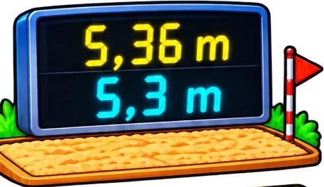 | **`marcador-de-salto-de-longitud-5-36-m-y-5-3-34cd`** Marcador de salto de longitud: 5,36 m y 5,3 m junto al foso de arena `5°` `aritmetica` `comparar` `decimales` `longitud` `medidas` `metros` | aritmetica · grado 5 | 5★ |
| 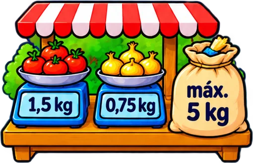 | **`puesto-de-frutas-con-dos-balanzas-1-5-kg-y-7202`** Puesto de frutas con dos balanzas (1,5 kg y 0,75 kg) y un costal «máx. 5 kg» `4°` `aritmetica` `balanza` `frutas` `kilogramos` `medidas` `mercado` | aritmetica · grado 4 | 5★ |
| 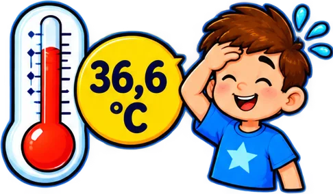 | **`termometro-que-marca-36-6-c-junto-a-un-nin-72b5`** Termómetro que marca 36,6 °C junto a un niño sudando por la fiebre `4°` `aritmetica` `decimales` `grados` `medidas` `salud` `temperatura` | aritmetica · grado 4 | 5★ |
| 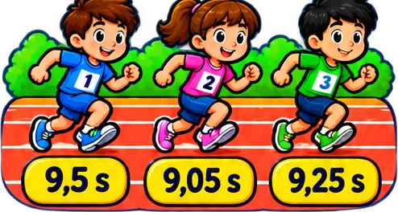 | **`tres-ninos-corriendo-con-sus-tiempos-9-5-s-e961`** Tres niños corriendo con sus tiempos 9,5 s · 9,05 s · 9,25 s `4°` `aritmetica` `carrera` `comparar` `decimales` `medidas` `segundos` | aritmetica · grado 4 | 5★ |
| 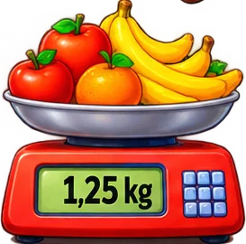 | **`balanza-digital-roja-con-frutas-manzanas-n-acc7`** Balanza digital roja con frutas (manzanas, naranjas y bananos) que marca 1,25 kg `4°` `aritmetica` `balanza` `decimales` `frutas` `kilogramos` `medidas` | aritmetica · grado 4 | 4★ |
