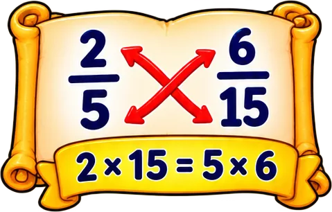
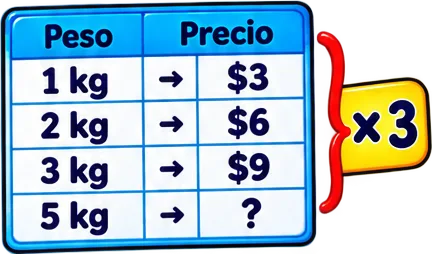

# tematicos/razones

3 imágenes · [← volver al índice](../CATALOGO.md)

| Imagen | Id y qué contiene | Materia · grado | Calidad |
|:--:|---|---|:--:|
|  | **`jugos-y-galletas-con-la-razon-2-3-d32d`** Jugos y galletas con la razón «2 : 3» `5°` `aritmetica` `galletas` `jugos` `proporcion` `razon` `razones` | aritmetica · grado 5 | 5★ |
|  | **`pergamino-con-la-proporcion-2-5-6-15-y-los-252f`** Pergamino con la proporción 2/5 = 6/15 y los productos cruzados 2 × 15 = 5 × 6 `5°` `aritmetica` `fracciones` `producto-cruzado` `proporcion` `razon` `razones` | aritmetica · grado 5 | 5★ |
|  | **`tabla-de-proporcion-pesoprecio-1-kg-3-2-kg-9f24`** Tabla de proporción peso–precio (1 kg → $3, 2 kg → $6, 3 kg → $9, 5 kg → ?) con «×3» `5°` `aritmetica` `multiplicar` `precio` `proporcion` `razon` `razones` | aritmetica · grado 5 | 5★ |
