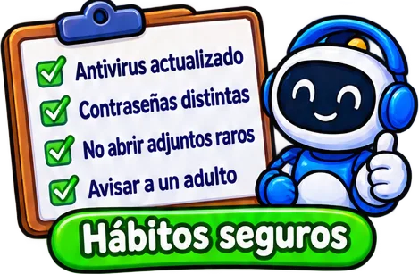
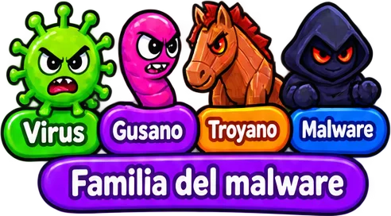
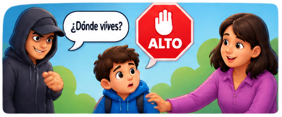
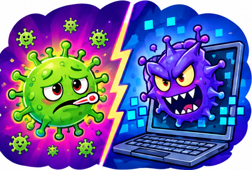
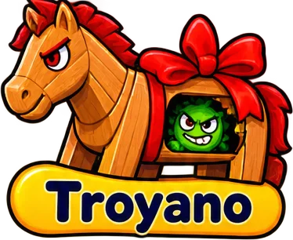

# tematicos/seguridad-digital

27 imágenes · [← volver al índice](../CATALOGO.md)

| Imagen | Id y qué contiene | Materia · grado | Calidad |
|:--:|---|---|:--:|
|  | **`archivo-foto-jpg-exe-con-alerta-roja-y-el-0d4c`** Archivo «foto.jpg.exe» con alerta roja y el letrero «Archivo sospechoso» `5°` `adjunto` `archivo-sospechoso` `exe` `extension` `seguridad-digital` `tecnologia` | tecnologia · grado 5 | 5★ |
|  | **`aria-con-lista-habitos-seguros-antivirus-a-8d9b`** ARIA con lista «Hábitos seguros»: antivirus actualizado, contraseñas distintas, no abrir adjuntos raros, avisar a un adulto `5°` `adjuntos` `antivirus` `aria` `contrasena` `habitos-seguros` `seguridad-digital` | tecnologia · grado 5 | 5★ |
|  | **`aria-con-un-escudo-dividido-en-cuatro-cand-4bfc`** ARIA con un escudo dividido en cuatro (candado, puerta, mano, teléfono) y «Mi escudo digital» `4°` `aria` `escudo-digital` `habitos` `seguridad` `seguridad-digital` `tecnologia` | tecnologia · grado 4 | 5★ |
|  | **`candado-con-no-publicar-direccion-telefono-500b`** Candado con «NO publicar»: dirección, teléfono y colegio `4°` `candado` `datos-personales` `no-publicar` `privacidad` `seguridad-digital` `tecnologia` | tecnologia · grado 4 | 5★ |
|  | **`candado-con-una-contrasena-segura-luz-mar5-75c5`** Candado con una contraseña segura «Luz#Mar5» y requisitos: letras, números, símbolos `4°` `candado` `clave` `contrasena` `segura` `seguridad-digital` `simbolos` | tecnologia · grado 4 | 5★ |
|  | **`correo-con-el-asunto-iloveyou-y-el-archivo-a847`** Correo con el asunto «ILOVEYOU» y el archivo LOVE-LETTER-FOR-YOU.TXT.vbs con alerta roja `5°` `adjunto` `correo` `gusano` `historia` `iloveyou` `seguridad-digital` | tecnologia · grado 5 | 5★ |
|  | **`escudo-con-candado-rodeado-de-virus-intrus-522a`** Escudo con candado rodeado de virus, intruso, fraude y ventana rara `4°` `amenazas` `escudo` `fraude` `malware` `seguridad` `seguridad-digital` | tecnologia · grado 4 | 5★ |
|  | **`escudo-con-cruz-y-una-lupa-que-revisa-un-v-e48b`** Escudo con cruz y una lupa que revisa un virus verde: «Antivirus» `5°` `antivirus` `escudo` `lupa` `proteccion` `seguridad-digital` `tecnologia` | tecnologia · grado 5 | 5★ |
|  | **`familia-del-malware-virus-gusano-troyano-y-dc08`** Familia del malware: virus, gusano, troyano y malware `5°` `familia` `gusano` `malware` `seguridad-digital` `tecnologia` `troyano` | tecnologia · grado 5 | 5★ |
|  | **`gusano-de-colores-con-cara-enojada-entre-c-383a`** Gusano de colores con cara enojada entre computadoras: «Se copia solo» `5°` `gusano` `malware` `se-copia-solo` `seguridad-digital` `tecnologia` `virus` | tecnologia · grado 5 | 5★ |
|  | **`img-14cb23e10e`**  `4°` `privacidad` `seguridad` `tecnologia` `tema` `virus` | — | 5★ |
|  | **`img-1eedb92639`**  `4°` `escenario` `fondo` `privacidad` `seguridad` `tecnologia` `virus` | — | 5★ |
|  | **`img-357e6e34a3`**  `5°` `privacidad` `seguridad` `tecnologia` `tema` `virus` | — | 5★ |
|  | **`img-c7c5297d8b`**  `5°` `privacidad` `seguridad` `tecnologia` `tema` `virus` | — | 5★ |
|  | **`img-d72d0443ae`**  `4°` `escenario` `fondo` `privacidad` `seguridad` `tecnologia` `virus` | — | 5★ |
|  | **`laptop-con-reloj-de-arena-lento-y-ventanas-49f1`** Laptop con reloj de arena, «Lento» y «Ventanas raras» como señales de virus `5°` `computador` `lento` `seguridad-digital` `senales` `tecnologia` `ventanas` | tecnologia · grado 5 | 5★ |
|  | **`laptop-con-un-virus-verde-enojado-y-una-al-8e3e`** Laptop con un virus verde enojado y una alerta roja: «Virus» `5°` `alerta` `computador` `malware` `seguridad-digital` `tecnologia` `virus` | tecnologia · grado 5 | 5★ |
|  | **`nino-incomodo-que-dice-esto-me-incomoda-y-d04d`** Niño incómodo que dice «¡Esto me incomoda!» y cuenta lo que vio a una persona adulta `4°` `adulto` `confianza` `incomodo` `pedir-ayuda` `riesgos-en-linea` `seguridad-digital` | tecnologia · grado 4 | 5★ |
|  | **`nino-que-pulsa-cerrar-sesion-en-una-comput-030c`** Niño que pulsa «Cerrar sesión» en una computadora `4°` `cerrar-sesion` `compartido` `computador` `cuenta` `seguridad` `seguridad-digital` | tecnologia · grado 4 | 5★ |
|  | **`pantalla-con-sobre-y-anzuelo-ganaste-un-pr-df47`** Pantalla con sobre y anzuelo: «¡Ganaste un premio! Haz clic aquí» (fraude) `4°` `anzuelo` `clic` `correo` `fraude` `phishing` `premio` | tecnologia · grado 4 | 5★ |
|  | **`sobre-con-clip-remitente-desconocido-y-una-6055`** Sobre con clip «Remitente desconocido» y una mano roja de «No abrir» `4°` `adjunto` `correo` `no-abrir` `phishing` `remitente-desconocido` `seguridad-digital` | tecnologia · grado 4 | 5★ |
|  | **`caballo-de-madera-con-lazo-y-un-virus-esco-ef47`** Caballo de madera con lazo y un virus escondido: «Troyano» `5°` `caballo` `malware` `seguridad-digital` `tecnologia` `troyano` `virus` | tecnologia · grado 5 | 4★ |
|  | **`img-6d8c221e63`**  `5°` `privacidad` `seguridad` `tecnologia` `tema` `virus` | — | 4★ |
|  | **`img-7fe78e06c7`**  `4°` `privacidad` `seguridad` `tecnologia` `tema` `virus` | — | 4★ ✂ |
|  | **`img-b4a99b045f`**  `5°` `personaje` `privacidad` `seguridad` `sprite` `tecnologia` `virus` | — | 4★ ✂ |
|  | **`img-b57d024a54`**  `4°` `personaje` `privacidad` `seguridad` `sprite` `tecnologia` `virus` | — | 4★ ✂ |
|  | **`img-cb1731b409`**  `4°` `personaje` `privacidad` `seguridad` `sprite` `tecnologia` `virus` | — | 4★ ✂ |
