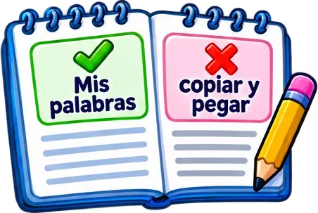
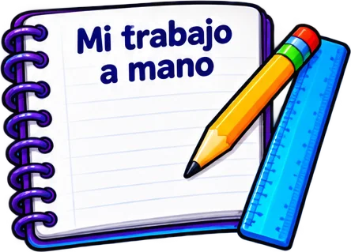
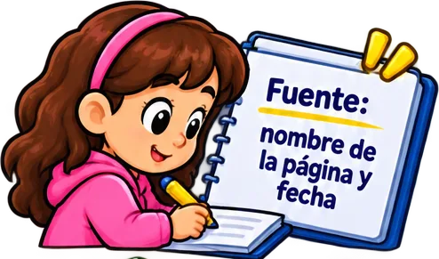
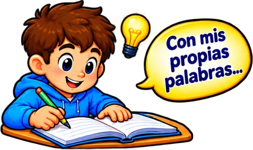
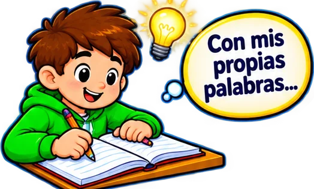

# tematicos/trabajo-escrito

8 imágenes · [← volver al índice](../CATALOGO.md)

| Imagen | Id y qué contiene | Materia · grado | Calidad |
|:--:|---|---|:--:|
|  | **`cuaderno-con-mis-palabras-palomita-y-copia-4026`** Cuaderno con «Mis palabras» (palomita) y «copiar y pegar» (X) `5°` `copiar` `parafrasear` `plagio` `propias-palabras` `tecnologia` `trabajo-escrito` | tecnologia · grado 5 | 5★ |
|  | **`cuaderno-espiral-mi-trabajo-a-mano-con-lap-3669`** Cuaderno espiral «Mi trabajo a mano» con lápiz y regla `4°` `5°` `cuaderno` `entregar` `mano` `tecnologia` `trabajo-escrito` | tecnologia · grado 4, 5 | 5★ |
|  | **`cuaderno-mi-trabajo-a-mano-con-lapiz-y-reg-79b1`** Cuaderno «Mi trabajo a mano» con lápiz y regla `5°` `aritmetica` `cuaderno` `entregar` `mano` `trabajo-escrito` | aritmetica · grado 5 | 5★ |
|  | **`nina-anotando-en-su-cuaderno-fuente-nombre-2785`** Niña anotando en su cuaderno «Fuente: nombre de la página y fecha» `5°` `citar` `cuaderno` `fuente` `investigar` `notas` `tecnologia` | tecnologia · grado 5 | 5★ |
|  | **`nina-celebrando-con-los-brazos-arriba-ante-cabe`** Niña celebrando con los brazos arriba ante una laptop con palomita verde y estrellas `4°` `celebracion` `laptop` `logro` `tecnologia` `trabajo-escrito` `trabajo-terminado` | tecnologia · grado 4 | 5★ |
|  | **`nino-escribiendo-en-su-cuaderno-con-el-glo-1fc3`** Niño escribiendo en su cuaderno con el globo «Con mis propias palabras…» `5°` `aritmetica` `cuaderno` `escribir` `explicar` `propias-palabras` `trabajo-escrito` | aritmetica · grado 5 | 5★ |
|  | **`nino-escribiendo-en-su-cuaderno-con-el-glo-3d4a`** Niño escribiendo en su cuaderno con el globo «Con mis propias palabras…» `4°` `aritmetica` `cuaderno` `escribir` `explicar` `propias-palabras` `trabajo-escrito` | aritmetica · grado 4 | 5★ |
|  | **`nino-escribiendo-en-su-cuaderno-con-el-glo-c72d`** Niño escribiendo en su cuaderno con el globo «Con mis propias palabras…» `4°` `5°` `cuaderno` `escribir` `explicar` `propias-palabras` `tecnologia` | tecnologia · grado 4, 5 | 5★ |
