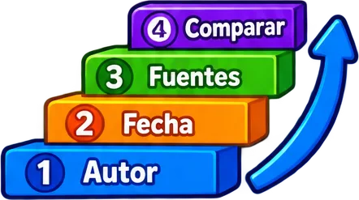
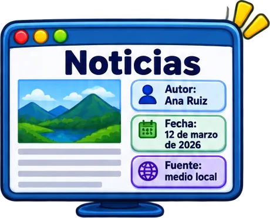
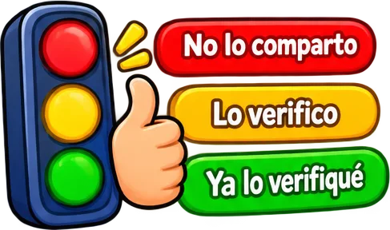
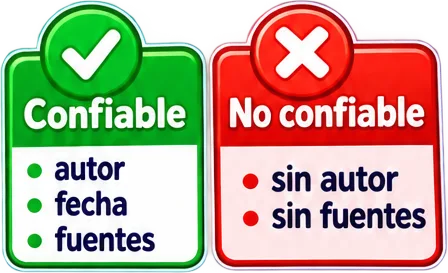

# tematicos/verificar-informacion

16 imágenes · [← volver al índice](../CATALOGO.md)

| Imagen | Id y qué contiene | Materia · grado | Calidad |
|:--:|---|---|:--:|
|  | **`aria-con-duda-ante-un-mensaje-compartelo-a-dbec`** ARIA con duda ante un mensaje «Compártelo a 10 amigos o tendrás mala suerte» y la pregunta «¿Será cierto?» `4°` `aria` `bulo` `cadena` `compartir` `tecnologia` `verificar` | tecnologia · grado 4 | 5★ |
|  | **`aria-con-lista-de-chequeo-url-y-dominio-au-ad6a`** ARIA con lista de chequeo: URL y dominio, autor, fecha, fuentes `4°` `aria` `autor` `dominio` `fecha` `fuentes` `lista-chequeo` | tecnologia · grado 4 | 5★ |
|  | **`aria-detective-con-lupa-y-comparo-en-otras-825c`** ARIA detective con lupa y «Comparo en otras fuentes» `5°` `aria` `comparar` `detective` `fuentes` `tecnologia` `verificar` | tecnologia · grado 5 | 5★ |
|  | **`dos-globos-bogota-es-la-capital-de-colombi-a613`** Dos globos: «Bogotá es la capital de Colombia» (Hecho) y «La pizza es la mejor comida» (Opinión) `5°` `diferencia` `ejemplo` `hecho` `opinion` `tecnologia` `verificar` | tecnologia · grado 5 | 5★ |
|  | **`escalera-de-4-pasos-para-verificar-1-autor-3a99`** Escalera de 4 pasos para verificar: 1 Autor, 2 Fecha, 3 Fuentes, 4 Comparar `5°` `autor` `comparar` `fecha` `fuentes` `pasos` `tecnologia` | tecnologia · grado 5 | 5★ |
|  | **`lupa-sobre-una-pagina-web-con-tres-casilla-4dea`** Lupa sobre una página web con tres casillas verificadas: autor, fecha y fuente `5°` `autor` `fecha` `fuente` `lupa` `pagina` `tecnologia` | tecnologia · grado 5 | 5★ |
|  | **`megafono-con-oferta-compra-ya-y-la-etiquet-263e`** Megáfono con «¡Oferta! Compra ya» y la etiqueta «publicidad» `5°` `oferta` `persuadir` `publicidad` `tecnologia` `tipos-informacion` `verificar-informacion` | tecnologia · grado 5 | 5★ |
|  | **`pagina-de-noticias-con-imagen-y-datos-auto-07d7`** Página de «Noticias» con imagen y datos: autor Ana Ruiz, fecha 12 de marzo de 2026, fuente medio local `5°` `autor` `confiable` `ejemplo` `fecha` `fuente` `noticia` | tecnologia · grado 5 | 5★ |
|  | **`pantalla-con-megafono-y-titulares-mayuscul-fff4`** Pantalla con megáfono y titulares «MAYÚSCULAS, dinero fácil, ¡compártelo ya!» con alerta `5°` `desinformacion` `mayusculas` `senales-engano` `tecnologia` `urgencia` `verificar-informacion` | tecnologia · grado 5 | 5★ |
|  | **`pulgar-con-cartel-10-000-me-gusta-verdad-t-dddf`** Pulgar con cartel «10.000 me gusta = verdad» tachado con una X `5°` `me-gusta` `opinion` `popular-no-es-verdad` `tecnologia` `verificar` `verificar-informacion` | tecnologia · grado 5 | 5★ |
|  | **`seis-tarjetas-de-tipos-de-informacion-noti-c931`** Seis tarjetas de tipos de información: noticia, video tutorial, enciclopedia, red social, publicidad y rumor `5°` `enciclopedia` `noticia` `publicidad` `rumor` `tecnologia` `tipos-informacion` | tecnologia · grado 5 | 5★ |
|  | **`semaforo-del-pulgar-rojo-no-lo-comparto-am-e62b`** Semáforo del pulgar: rojo «No lo comparto», amarillo «Lo verifico», verde «Ya lo verifiqué» `5°` `compartir` `decision` `semaforo` `tecnologia` `verificar` `verificar-informacion` | tecnologia · grado 5 | 5★ |
|  | **`senora-con-celular-que-dice-reenvia-a-10-p-fcf7`** Señora con celular que dice «¡Reenvía a 10 personas!» y ARIA con duda `5°` `aria` `bulo` `cadena` `reenviar` `tecnologia` `verificar` | tecnologia · grado 5 | 5★ |
|  | **`tarjetas-confiable-autor-fecha-fuentes-y-n-1748`** Tarjetas «Confiable» (autor, fecha, fuentes) y «No confiable» (sin autor, sin fuentes) `4°` `autor` `confiable` `fecha` `fuente` `tecnologia` `verificar` | tecnologia · grado 4 | 5★ |
|  | **`tres-paginas-imagen-video-mundo-comparadas-2a54`** Tres páginas (imagen, video, mundo) comparadas con una lupa sobre un libro: «Comparo» `5°` `comparar` `fuentes` `lupa` `paginas` `tecnologia` `verificar-informacion` | tecnologia · grado 5 | 5★ |
|  | **`video-con-tijeras-y-alerta-los-videos-tamb-27cf`** Video con tijeras y alerta: «Los videos también pueden engañar» `5°` `desinformacion` `editado` `enganar` `tecnologia` `verificar` `verificar-informacion` | tecnologia · grado 5 | 5★ |
